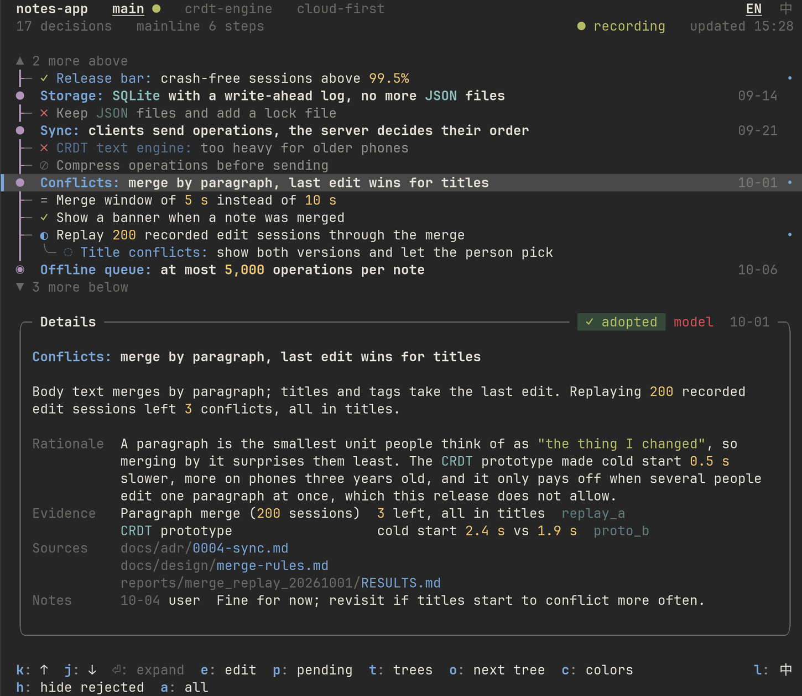
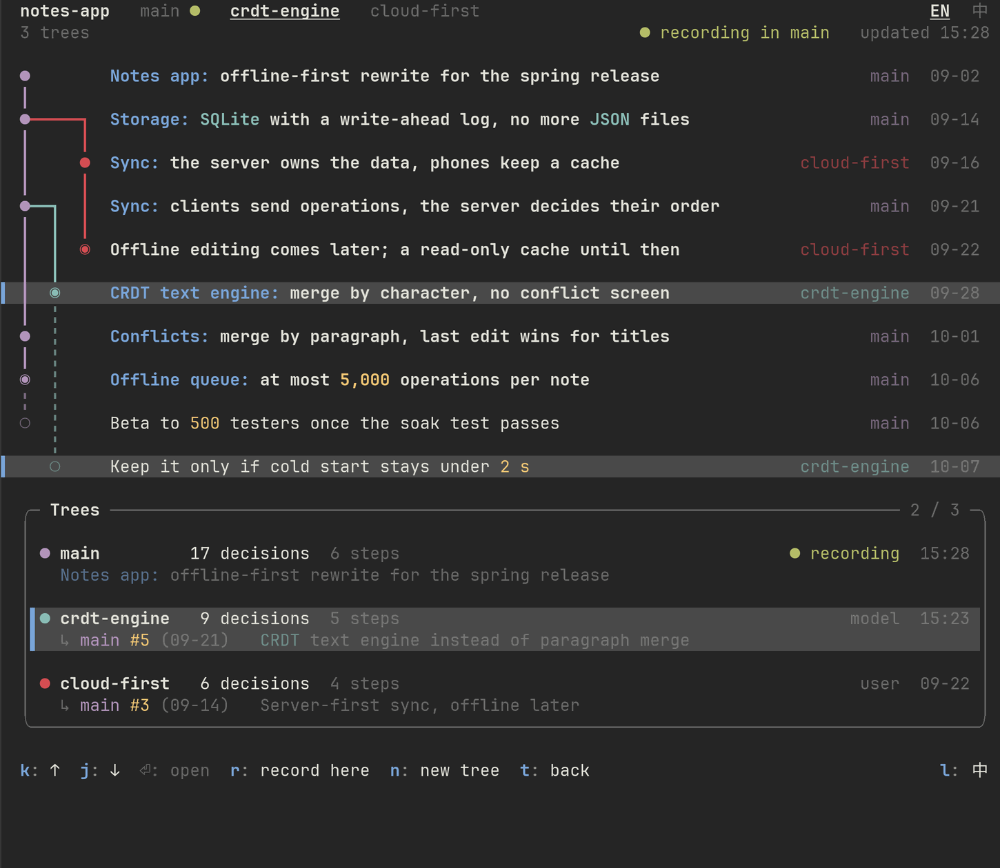
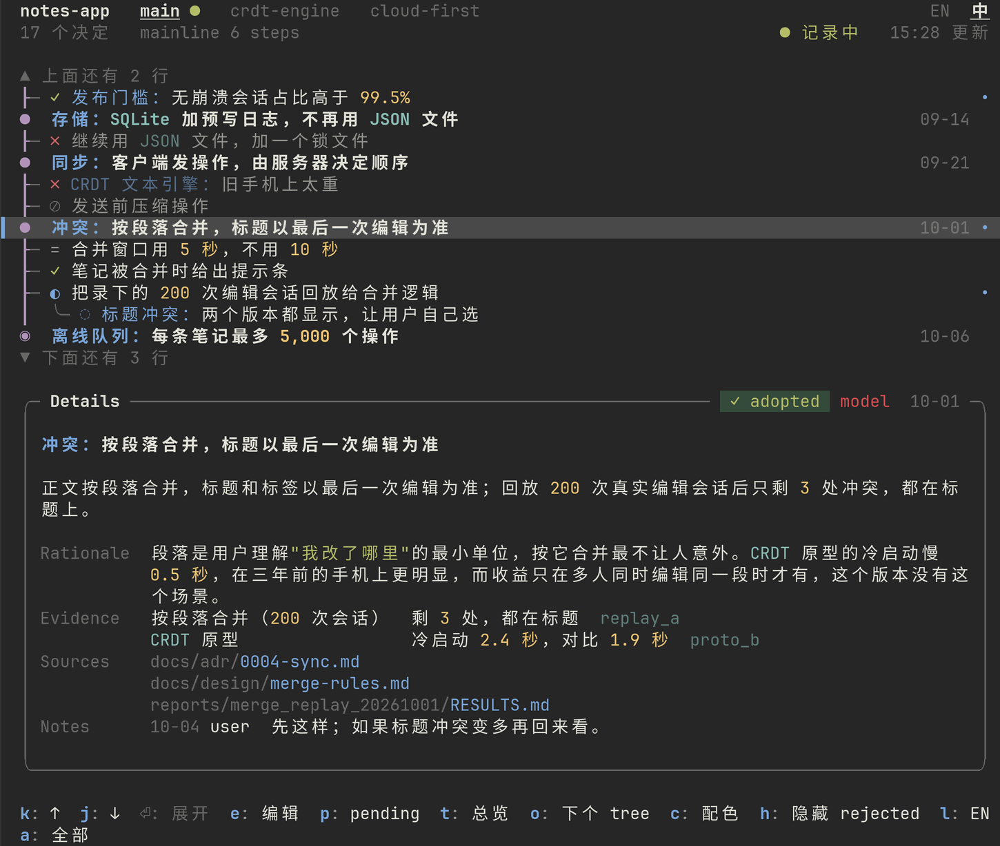
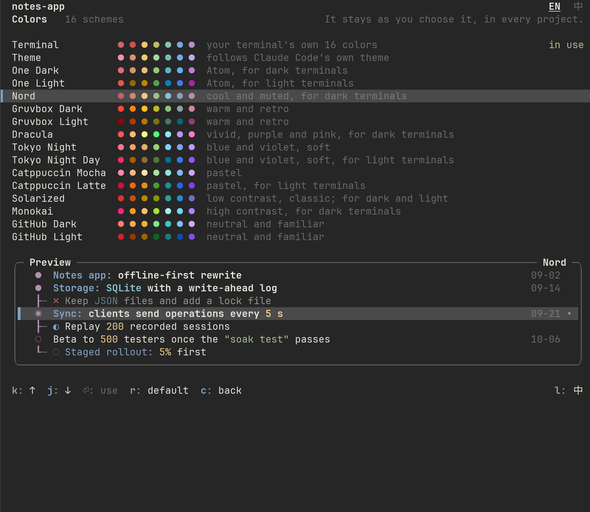

# decision-tree

**English** | [简体中文](README.zh-CN.md)

A general-purpose Claude Code mod that records the decisions made in a project as a tree and shows it in a pane docked on the right of the terminal.



*Drawn by the pane's own layout code from a made-up sample project. The fonts and colors are those of your terminal; the picture uses a typical dark theme.*

- **Claude writes it down, you keep the say.** Decisions are recorded by Claude, as you work, through tools the mod registers. You can also change them with commands, or by hand in the pane.
- **A rail and a frame.** The mainline is drawn as the spine of a graph, with what was tried and dropped hanging off it. Below it, a frame tells the whole story of the selected decision: rationale, evidence, sources, notes. Words that matter (numbers, dates, names, quotes) are colored the way code is.
- **Several trees.** Open a new tree from the current version, or from any earlier version, and keep recording there (like branching in git). The original stays untouched. Tabs switch between trees, and a Trees overview draws them as a graph. See [Several trees](#several-trees).
- **English and Chinese, switchable at any time.** Every decision can be read in English; one key (`l`) or a click on `EN 中` switches the pane. In Chinese, professional names and everyday work words (bug, doc, commit, …) stay English. See [Language](#language).
- **16 color schemes.** Your terminal's own colors by default, so the pane looks like the rest of your terminal; or One Dark, Nord, Gruvbox, Dracula, Catppuccin, … Press `c`. See [Colors](#colors).
- **The record lives in the project.** The data is plain text in `.claude/decisions/`. Every session started in that project reads the same record and keeps adding to it; sync it with git and the tree follows you across machines.
- **A "Now" block** (optional) above the tree: a status command that the project configures itself (it prints JSON) is refreshed every 30 seconds and shows long-running jobs, their estimated finish times and the next gate.
- It contains no project names, paths or machine names. Everything specific to a project lives in that project's own `config.json`.

**Quick start**

```
/plugin install decision-tree --marketplace xwzhang98/decision-tree
```

Then, in any project, run `/decide init`: Claude looks through the project, records where it starts, and the pane fills in (open it with `/tree`). For an empty tree instead, tell Claude "start recording decisions from now" or run `/decide start`. Details are in [Installation](#installation) and [Getting started](#getting-started).

## Contents

1. [Prerequisites](#prerequisites)
2. [Installation](#installation)
3. [Getting started](#getting-started)
4. [Commands](#commands)
5. [The pane](#the-pane)
6. [Several trees](#several-trees)
7. [Language](#language)
8. [Colors](#colors)
9. [The "Now" block and the status command](#the-now-block-and-the-status-command)
10. [Ghostty and other terminals](#ghostty-and-other-terminals)
11. [Tools for the model](#tools-for-the-model)
12. [Data format](#data-format)
13. [Behavior to know about](#behavior-to-know-about)
14. [Development and tests](#development-and-tests)
15. [Using it in your own project](#using-it-in-your-own-project)
16. [Implementation notes and assumptions](#implementation-notes-and-assumptions)
17. [Third-party notices](#third-party-notices)
18. [Authors](#authors)
19. [License](#license)

## Prerequisites

- Written against the mod API of Claude Code **2.1.296** (`claude plugin validate`, `tsc -p` and `claude plugin test` all pass on that version). The mod API changes with every version: after changing versions, run validate and test first, see [Development and tests](#development-and-tests).
- With the fullscreen terminal layout the pane docks on the right and shares the space with the diff panel as tabs. The width rules belong to the engine. When a project is already recording, the mod opens the pane **on its own**, and it only draws once the terminal is at least 144 columns wide (110 is enough after you have opened it once with `/tree`); on a narrower terminal it waits and appears when you widen the window. A pane you open yourself with `/tree` or `/decide` docks on the right from 110 columns; on a narrower terminal it is drawn above the prompt (see [Behavior to know about](#behavior-to-know-about)).
- It needs no external program. The only external commands it runs are `git rev-parse` and `git check-ignore` (to find the project root and to check `.gitignore`), and the status command you have approved.
- Its one use of the network is the optional background translation: the texts of your decisions that lack a version in the other language are sent to your session's own model, with your session's own credentials. Nothing else leaves the machine. `/decide translate off` stops it; see [Language](#language).

## Installation

### From GitHub

```
/plugin install decision-tree --marketplace xwzhang98/decision-tree
```

Claude Code asks `Add marketplace?`: press `y`, choose **Install for you (user scope)** and press Enter. When `Installed decision-tree. Plugin is now active.` appears it is installed: it takes effect in the current session at once, and every session you start on this machine from now on loads it.

The same from the command line:

```bash
claude plugin marketplace add xwzhang98/decision-tree
claude plugin install decision-tree@decision-tree --scope user
```

To publish your own copy, push this folder as the root of a repository (`.claude-plugin/marketplace.json` is already written) and use `/plugin install decision-tree --marketplace <owner>/<repo>`.

### On a remote server (without interrupting running sessions)

Sessions on a remote server may be carrying unattended, long-running job queues. **Do not restart them to install or debug**: open another Claude Code session to install and try the mod. The sessions that are already running are not affected (they do not load the mod until you restart them).

1. Copy the whole folder to the server, for example to `~/mods/decision-tree`:

   ```bash
   rsync -a --exclude '.claude-plugin/types' decision-tree/ server:~/mods/decision-tree/
   ```

   (If the server can reach GitHub you can skip the copy and use the GitHub install above in that new session.)

2. In that new Claude Code session type:

   ```
   /plugin install decision-tree --marketplace ~/mods/decision-tree
   ```

   Press `y` at `Add marketplace?`, choose **Install for you (user scope)** and press Enter. When `Installed decision-tree. Plugin is now active.` appears it is installed: it takes effect in the current session at once, and every session you start on this machine from now on loads it.

3. To change the code later, edit `~/mods/decision-tree` directly and run `/reload-plugins` in the session.

Outside the interactive UI you can use the command line:

```bash
claude plugin marketplace add ~/mods/decision-tree
claude plugin install decision-tree@decision-tree --scope user
```

### Try it without installing

```bash
claude --plugin-dir ~/mods/decision-tree
```

It applies to that one session only, and reloads by itself when you edit the files.

## Getting started

A project is **not recorded** by default. Without `.claude/decisions/config.json` the mod writes no file, the system prompt gets one extra line ("If the user asks to start recording this project's decisions …, call decision_log_start."), and the model sees only one tool, `decision_log_start`.

There are three ways to turn recording on:

- run `/decide init [title]`: it turns recording on **and** has Claude look through the project and record where it starts, see [Setting up from the project itself](#setting-up-from-the-project-itself);
- say "start recording decisions from now" in a prompt (the Chinese "从现在开始记录决定" works too) and the model calls `decision_log_start`;
- or run `/decide start [title]` yourself.

The last two begin with an empty tree.

Once on, the mod: writes `config.json` and a `start` event; registers the other six tools (`decision_record`, `decision_update`, `decision_note`, `decision_tree`, `decision_new_tree`, `decision_use_tree`); replaces the system-prompt section with the full version; and the session that turned it on opens the pane (when you turn it on with `/decide start` the pane also gets the keyboard, with `/decide init` it does not, because Claude starts working at once; it only draws if there is room, see [Prerequisites](#prerequisites)). Other sessions already running in this project notice `config.json` within 5 seconds and switch to on as well; if their terminal uses the fullscreen layout and `display.autoOpen` is true, each of them opens the pane once.

Pause and resume with `/decide pause` and `/decide resume`. While paused, the model's write tools answer "Not recorded: decision recording is paused", and the system-prompt section shrinks to one line saying recording is paused. Your own commands and manual edits in the pane still work.

If the project's `.gitignore` ignores `.claude/`, turning recording on prints "Note: .gitignore ignores .claude/, so these files will not reach git." The mod **never edits `.gitignore`**. Git cannot re-include a path inside an ignored directory, so to get `decisions/` into git change `.claude/` to:

```
.claude/*
!.claude/decisions/
```

### Setting up from the project itself

`/decide init [title]` is to this mod what `/init` is to Claude Code: instead of starting with an empty tree, Claude looks through the project and records where it stands.

```
Started recording decisions for notes-app (data in .claude/decisions/)
Asked Claude to look through the project and record where it starts; the
pane fills as it goes.
```

1. If recording is off, the mod turns it on (like `/decide start`, except that the pane does not take the keyboard).
2. A moment later it hands Claude a task, as if you had typed it: look through the README and docs, notes, `CLAUDE.md` / `AGENTS.md`, decision records (`docs/adr`, `DECISIONS.md`), the changelog, the last 30 commits and the tags, the main config and manifest files and the layout of the code. A quick look, about a dozen reads.
3. Claude records the **starting point** with `decision_record`: the root of the mainline (a milestone, adopted) saying what the project is and where it stands, with the files it used as `sources`.
4. Then, under it, up to seven decisions the project has clearly already made: `adopted` for what the files say is decided or in use, `rejected` for alternatives they say were dropped, `planned` or `proposed` for what they list as next or still open. Each has its sources, and a `decidedAt` date when a commit or a document gives one. Nothing is invented: what the files do not show is left out.
5. It ends with two or three sentences on what it recorded and what it could not tell.

What it leaves behind looks like this (a made-up project, as Claude might record it):

```
  notes-app                                                                                  EN  中
  6 decisions   mainline 1 step                                         ● recording   updated 15:28

▌ ◉  Notes app: v1 in production                                                            03-14
  ┠─ ✓ Store notes as JSON files on disk
  ┠─ ✓ Sync through a REST endpoint, polling every 60 s
  ┠─ ✗ Real-time sync over websockets
  ┠─ ○ Offline-first rewrite for the spring release
  ┖─ ◌ Desktop client

  ╭─ Details ──────────────────────────────────────────────────────────  ✓ adopted  model  03-14 ─╮
  │                                                                                               │
  │ Notes app: v1 in production                                                                   │
  │                                                                                               │
  │ A notes app for phones and the web, live since March. Notes are JSON files on disk and sync   │
  │ through a REST endpoint.                                                                      │
  │                                                                                               │
  │ Sources  README.md                                                                            │
  │          CHANGELOG.md                                                                         │
  │                                                                                               │
  ╰───────────────────────────────────────────────────────────────────────────────────────────────╯

  k: ↑  j: ↓  ⏎: expand  e: edit  p: pending  t: trees  c: colors  h: hide rejected  a: all   l: 中
```

It changes no file in your project (the record in `.claude/decisions/` apart), runs none of the project's code, starts no jobs and skips secrets such as `.env` files. It writes only through the ordinary `decision_record` tool, so everything it records can be edited in the pane, corrected with `/decide status`, or taken back with `/decide retract`, like any other node. It is a request to the model, not a program: what it records depends on what the project's files say and how the model reads them, so look the result over. Reading the project goes through the usual permission prompts of your Claude Code settings.

`/decide init` sets up an **empty** tree only. In a tree that already has decisions it says so and does nothing (`/decide new <name> --empty` opens an empty tree to run it in); while recording is paused it asks you to `/decide resume` first. The task starts a turn of its own once the session is idle, so if Claude is busy it waits until the current turn ends. The records are written in Chinese when `display.language` is `zh`, or when it is `auto` and you have typed Chinese; in English when it is `en`; otherwise in the language you write in (English if Claude cannot tell). Whenever they are not English, Claude also hands over the English version of each text, so the pane can show English at once, see [Language](#language). The wording of the task is in `lib/init.ts`.

## Commands

| Command | What it does |
|---|---|
| `/tree` | Opens the pane (or switches to it) and gives it the keyboard. If the screen has no room for the pane, returns the tree as text |
| `/decide init [title]` | Turn recording on **and** have Claude look through the project and record where it starts, see [Setting up from the project itself](#setting-up-from-the-project-itself) |
| `/decide start [title]` | Turn recording on by hand, with an empty tree |
| `/decide pause`, `/decide resume` | Pause, resume |
| `/decide status <id> <status>` | Change a status, e.g. `/decide status replay-200 adopted`. A status can be written as its id, its English name or its Chinese name (`采用`, `否决`, `进行中`, …) |
| `/decide note <id> <text>` | Add a note |
| `/decide add <title> --parent <id> [--status planned]` | Add a node by hand. Also `--kind decision\|protocol\|design\|milestone`, `--id <slug>`, `--trunk` |
| `/decide retract <id> <reason>` | Take back a record made by mistake (not the same as a decision being `withdrawn`) |
| `/decide import <file>` | Import a batch of nodes, see [Importing seed data](#importing-seed-data) |
| `/decide new <name> [--at <version>] [--from <tree>] [--title <text>] [--empty] [--stay]` | Open a new tree: it starts as a copy of the current version (or of the version `--at` names) and the project switches to it, see [Several trees](#several-trees) |
| `/decide use <name>` | Switch to another tree (`main` is the first one) |
| `/decide tree` | List the project's trees, where each was opened from, and how big each is |
| `/decide log [N]` | The last N events of the current tree (default 12, at most 60), numbered: `#N` is a version you can use with `--at` |
| `/decide` (no arguments) | Open the pane and start editing the selected node |
| `/decide lang en\|zh\|auto` | Fix the pane's language for everybody in the project, or go back to automatic (written to `config.json`; it also drops the choice you made yourself with the `l` key), see [Language](#language) |
| `/decide translate on\|off` | Whether texts that lack a version in the other language are translated in the background by your session's model (written to `config.json`); `on` also makes it try again after it gave up |
| `/decide colors [name\|reset]` | The color scheme: without a name it says which one is in use, `reset` goes back to Terminal. Kept for you, in every project, see [Colors](#colors) |
| `/decide autoopen on\|off` | Whether the pane opens by itself once recording is on |

Wherever `<id>` is expected you can also give a piece of a title that matches exactly one node; if several match, the command lists the candidate ids. Events written by hand have `actor` `"user"`. A command returns a one-line receipt. The three tree commands also have a long form, `/decide tree new|use|log` (`list` is the same as `/decide tree`); `new` can also be written `fork`, `新建` or `新开`, and `use` can also be written `switch` or `切换`. `/decide colors` can also be written `/decide 配色`.


## The pane

The pane opens 72 columns wide and 24 rows tall (the layout works from 16 columns up and adapts to whatever room it is given). This is what it draws, as text, at that size (English, the made-up sample project):

```
  notes-app   main ●   crdt-engine   cloud-first                 EN  中
  17 decisions   mainline 6 steps           ● recording   updated 15:28

  ▲ 5 more above
  ●  Sync: clients send operations, the server decides their …  09-21
  ┠─ ✗ CRDT text engine: too heavy for older phones
  ┠─ ⊘ Compress operations before sending
▌ ●  Conflicts: merge by paragraph, last edit wins for titles   10-01 •
  ┠─ = Merge window of 5 s instead of 10 s
  ┠─ ✓ Show a banner when a note was merged
  ▼ 6 more below

  ╭─ Details ──────────────────────────────  ✓ adopted  model  10-01 ─╮
  │ Conflicts: merge by paragraph, last edit wins for titles          │
  │ Body text merges by paragraph; titles and tags take the last      │
  │ edit. Replaying 200 recorded edit sessions left 3 conflicts, all  │
  │ in titles.                                                        │
  │ Rationale  A paragraph is the smallest unit people think of as    │
  │            "the thing I changed", so merging by it surprises them │
  │ …                                                                 │
  ╰───────────────────────────────────────────────────────────────────╯

  k: ↑  j: ↓  ⏎: expand  e: edit  p: pending  t: trees            l: 中
  o: next tree  c: colors  h: hide rejected  a: all
```

From top to bottom:

- **The strip.** The project's name in bold, then, once the project has more than one tree, a tab for each (see [Several trees](#several-trees)): the tree you are looking at is bold and underlined, and the tree recording goes to has a green `●`. At the right, `◌ translating 14` while texts are being translated, and the language switch `EN  中`, whose current language is bold and underlined (see [Language](#language)).
- **The state line.** How many decisions the tree holds and how long its mainline is, whether it is recording (`● recording`, `● paused`) and when it last changed. When you are looking at a tree the project does not record into, it reads `○ read only   recording in main` instead. In a narrow pane the update time goes first, then the mainline.
- **The origin line**, for a tree that was opened from another one, from 16 rows up: `↳ main #5 (09-21)   CRDT text engine instead of paragraph merge`, where it began and what the tree is for.
- **The rail.** The mainline drawn as the spine of a graph, one step per row, with what was tried at each step hanging off it (below). The date at the right of a step is when it was decided.
- **The details** of the selected row, in a frame: its title, summary, then *Rationale*, *Evidence*, *Sources* and *Notes* under labels of their own. The top edge carries a chip with the status, who decided it (`user`, `model`, `gate`) and the date. When the node replaces or is replaced by another one, a line says so.
- **The key hints.** Each is a button: press the key, or click it. A key that is not drawn does not work, so in a narrow pane the least useful ones go first (up to three lines of them from 24 rows, two from 12, one below that). The count of warnings (event files that could not be read, say) appears at the right end only when there are any; `l` never goes.

The pane is a normal surface of Claude Code: everything in it is clickable (rows, tabs, `EN  中`, the key hints, `▲ … more above`), and `↑` `↓` work as well as `k` `j`.

### The rail

| Mark | Meaning |
|---|---|
| `●` | A step of the mainline |
| `◉` | The head: the newest step that was adopted, where the project is |
| `○` (dim) | A step still ahead: planned or proposed |
| `┃` and `╏` | The spine between steps: solid once the way there is done, dashed where it leads on to a step still ahead |
| `┠─` | A branch: something tried or decided at that step, in the order it was decided. `┖─` is the last branch of the last step, where the spine ends |
| `╰─` | A branch of a branch |
| `•` | At the end of a row: changed in the last 24 hours |
| `+3` | Three rows folded away under this one |
| `▌` | The selected row (with a band across the pane) |
| `▲ 5 more above` `▼ 6 more below` | The rail scrolls; these are buttons that page |

The steps are the nodes marked `trunk` (the mainline) and the roots; everything else hangs off the step above it. The branches of a step are open by default, and so are the sub-branches that are still pending or changed in the last 48 hours; pressing `⏎` on the selected row opens or closes what is under it (the `p` and `a` filters open everything). In a tree with no `trunk` node the roots are the steps.

Status symbols and colors (the colors are theme colors; a [color scheme](#colors) may recolor them):

| status | symbol | ASCII | color |
|---|---|---|---|
| `adopted` | ✓ | `+` | green |
| `rejected` | ✗ | `x` | red |
| `no-diff` | = | `=` | gray |
| `in-progress` | ◐ | `~` | accent |
| `planned` | ○ | `o` | accent |
| `proposed` | ◌ | `?` | accent, dim |
| `withdrawn` | ⊘ | `/` | gray, dim |
| `superseded` | ⊘ | `/` | gray, dim |
| `deferred` | ‖ | `"` | gray, dim |

Decisions that are over or parked (rejected, withdrawn, superseded, deferred) are drawn dim, title and all. The names are the same in both languages of the pane, because they are what the commands take.

Words that matter are colored the way code is, always the same kind of word in the same color, and nothing else:

| Kind | Examples | Color |
|---|---|---|
| Topic | the part of a title before its first colon (`Sync:`), and file names in *Sources* | blue |
| Number | `99.5%`, `5 s`, `5,000`, `#5` | yellow |
| Term | `SQLite`, `CRDT`, `proto_b` (ALLCAPS, snake_case, camelCase) | cyan |
| Quote | `"soak test"` | green |
| Date | `09-21`, `15:28` | gray |

In the details the model shows in Claude's color and the person in plain text.

◐ ○ ◌ ⊘ and the line and block characters (─ ┃ ╭ █ ░ …) have "ambiguous width" in Unicode, and some terminals draw them two columns wide. By default they are counted as one column (as Claude Code's own layout does). If your terminal draws them crooked, set `display.asciiGlyphs: true` in `config.json`, and the status symbols, the rail, the frames, the marks and the progress bars switch to ASCII (this is the same pane at 80 columns):

```
  notes-app   main *   crdt-engine   cloud-first                         EN  中
  17 decisions   mainline 6 steps                   * recording   updated 15:28

  ^ 4 more above
  |- x Keep JSON files and add a lock file
  *  Sync: clients send operations, the server decides their order      09-21
  |- x CRDT text engine: too heavy for older phones
  |- / Compress operations before sending
> *  Conflicts: merge by paragraph, last edit wins for titles           10-01 *
  |- = Merge window of 5 s instead of 10 s
  |- + Show a banner when a note was merged
  |- ~ Replay 200 recorded edit sessions through the merge                    *
  v 5 more below

  +- Details --------------------------------------  + adopted  model  10-01 -+
  | Conflicts: merge by paragraph, last edit wins for titles                  |
  | Body text merges by paragraph; titles and tags take the last edit.        |
  | Replaying 200 recorded edit sessions left 3 conflicts, all in titles.     |
  | Rationale  A paragraph is the smallest unit people think of as "the thing |
  |            I changed", so merging by it surprises them least. The CRDT    |
  |            prototype made cold start 0.5 s slower, more on phones three   |
  |            years old, and it only pays off when several people edit one   |
  |            paragraph at once, which this release does not allow.          |
  | Evidence   Paragraph merge (200 sessions)  3 left, all in titles  replay… |
  |            CRDT prototype                  cold start 2.4 s vs 1.9 s      |
  | …                                                                         |
  +---------------------------------------------------------------------------+

  k: up  j: down  Enter: expand  e: edit  p: pending  t: trees            l: 中
  o: next tree  c: colors  h: hide rejected  a: all
```

For Ghostty see [the section on terminals](#ghostty-and-other-terminals).

### Keys

They work when the pane has the keyboard: `/tree` (or `ctrl+x` then `Tab`) hands the keyboard to the pane, and `Esc` gives it back to the prompt.

| Key | Action |
|---|---|
| `k` `j` (or `↑` `↓`) | Move the selection |
| `⏎` | Press the selected row again to open or close what is under it |
| `e` | Edit the selected node: its status (one of nine) and a one-line summary; on save an `update` event is written. Only in the tree recorded into, and only where the screen has a text field |
| `p` | Pending only (planned, proposed, in progress); press again to go back |
| `h` | Hide rejected and withdrawn; press again to go back |
| `a` | Show everything, retracted records included; press again to go back |
| `s` | Show or hide the "Now" block (only when the project has a status command) |
| `t` | The Trees overview, see [Several trees](#several-trees) |
| `o` | Look at the next tree (only when the project has more than one) |
| `c` | The colors, see [Colors](#colors) |
| `l` | Switch the language of the pane |
| `Esc` | Give the keyboard back to the prompt |

While a filter is on, a line under the state line says so (`pending only`, `rejected hidden`, `showing everything`).

### When there is little room

From 20 rows up, blank rows set the parts apart; from 24 rows the rail has a line of spine between its steps, and from 26 the details have room to breathe, each only when the whole still fits. When the pane is short the rail is given a useful height first (about a third of the pane, between 4 and 12 rows), so the details are cut to make room, down to six lines; if that is not enough the "Now" block goes, then the details shrink further and finally go. The key hints at the bottom never give way. A status command that awaits your approval is the exception: it takes priority over the details. If even the whole command plus its button does not fit, no button is drawn and the "Now" block shows one line, `A status command awaits your OK; enlarge the pane to read it.`; the command and **Allow** appear once the pane is larger.

All truncation and wrapping is done by **display width** (CJK and fullwidth characters take two columns, combining marks zero, ambiguous-width characters one), using the number of columns the pane can actually draw. Titles are cut with `…`, the tabs give up their length and then their neighbours of the viewed one, and the details and the keys wrap to the width they have.

## Several trees

A project has one tree by default, called `main`. When you want to try a different line of thought ("same premise, another approach") without messing up the record you have, open a new tree. It starts as a copy of some **version** of a tree; everything recorded afterwards goes only into the new tree, and the original stays exactly as it was and can be switched back to at any time. It is the same idea as a branch in git.

### Tabs

Once the project has more than one tree, the strip carries a tab for each. Click a tab, or press `o`, to look at that tree. The tree you look at is not always the one recording goes to: the green `●` marks the recording tree, and any other tree is read only (the state line says `○ read only   recording in main`, `e` is not offered, and `/decide` with no arguments tells you to press `t`, select the tree and press `r` to record in it). This is the `crdt-engine` tree, opened from the Sync step of `main` and seen while recording is still going to `main`:

```
  notes-app   main ●   crdt-engine   cloud-first                                             EN  中
  9 decisions   mainline 5 steps                    ○ read only   recording in main   updated 15:28
  ↳ main #5 (09-21)   CRDT text engine instead of paragraph merge

  ●  Notes app: offline-first rewrite for the spring release                                09-02
  ┃
  ●  Storage: SQLite with a write-ahead log, no more JSON files                             09-14
  ┠─ ✗ Keep JSON files and add a lock file
  ┃
  ●  Sync: clients send operations, the server decides their order                          09-21
  ┃
  ◉  CRDT text engine: merge by character, no conflict screen                               09-28
  ┠─ ✓ Tombstones: compact once a week
▌ ┠─ ◐ Prototype on three older phones                                                            •
  ┃  ╰─ ◌ Fallback: paragraph merge for notes over 50 KB                                          •
  ╏
  ○  Keep it only if cold start stays under 2 s                                             10-07

  ╭─ Details ──────────────────────────────────────────────────────  ◐ in progress  model  10-07 ─╮
  │                                                                                               │
  │ Prototype on three older phones                                                               │
  │                                                                                               │
  │ The prototype runs on three phones that are three years old: cold start takes 2.4 s with the  │
  │ CRDT engine against 1.9 s with paragraph merge.                                               │
  │                                                                                               │
  │ Rationale  Merging by character removes the conflict screen, but it only pays off if cold     │
  │            start stays inside the 2 s budget on older phones, and the first numbers say it    │
  │            does not yet. Compacting tombstones weekly is already in; trimming the index that  │
  │            loads at start is next.                                                            │
  │ Evidence   Cold start, CRDT engine      2.4 s on 3 phones  proto_c                            │
  │            Cold start, paragraph merge  1.9 s  proto_b                                        │
  │ Sources    docs/design/crdt-prototype.md                                                      │
  │            reports/crdt_cold_start_20261007/RESULTS.md                                        │
  │ Notes      10-07 model  Trimming the index is the next experiment.                            │
  │                                                                                               │
  ╰───────────────────────────────────────────────────────────────────────────────────────────────╯

  k: ↑  j: ↓  ⏎: expand  p: pending  t: trees  o: next tree  c: colors  h: hide rejected      l: 中
  a: all
```

### The Trees overview

`t` opens the overview of the project's trees (and `t` again goes back):



```
  notes-app   main ●   crdt-engine   cloud-first                                             EN  中
  3 trees                                                       ● recording in main   updated 15:28

  ●        Notes app: offline-first rewrite for the spring release                     main  09-02
  ┃
  ●━━━━━┓  Storage: SQLite with a write-ahead log, no more JSON files                  main  09-14
  ┃     ┃
  ┃     ●  Sync: the server owns the data, phones keep a cache                  cloud-first  09-16
  ┃     ┃
  ●━━┓  ┃  Sync: clients send operations, the server decides their order               main  09-21
  ┃  ┃  ┃
  ┃  ┃  ◉  Offline editing comes later; a read-only cache until then            cloud-first  09-22
  ┃  ┃
▌ ┃  ◉     CRDT text engine: merge by character, no conflict screen             crdt-engine  09-28
  ┃  ╏
  ●  ╏     Conflicts: merge by paragraph, last edit wins for titles                    main  10-01
  ┃  ╏
  ◉  ╏     Offline queue: at most 5,000 operations per note                            main  10-06
  ╏  ╏
  ○  ╏     Beta to 500 testers once the soak test passes                               main  10-06
     ╏
▌    ○     Keep it only if cold start stays under 2 s                           crdt-engine  10-07

  ╭─ Trees ─────────────────────────────────────────────────────────────────────────────── 2 / 3 ─╮
  │                                                                                               │
  │ ● main         17 decisions  6 steps                                       ● recording  15:28 │
  │   Notes app: offline-first rewrite for the spring release                                     │
  │                                                                                               │
  │▌● crdt-engine   9 decisions  5 steps                                             model  15:23 │
  │▌  ↳ main #5 (09-21)   CRDT text engine instead of paragraph merge                             │
  │                                                                                               │
  │ ● cloud-first   6 decisions  4 steps                                              user  09-22 │
  │   ↳ main #3 (09-14)   Server-first sync, offline later                                        │
  ╰───────────────────────────────────────────────────────────────────────────────────────────────╯

  k: ↑  j: ↓  ⏎: open  r: record here  n: new tree  t: back                                   l: 中
```

- **The graph** is every step of every tree in the order it was decided, one lane per tree and each tree in a color of its own. A heavy line (`●━━┓`) leaves the lane of the tree a new one was opened from, at the step it was opened at. The step that is the head of its tree is `◉`, steps still ahead are `○`, and the spine is dashed where it leads to one. The highlighted tree's own steps carry `▌`.
- **The list** has one entry for each tree: its name, how many decisions and steps it holds, who wrote last (`model` or `user`) and when, and under it where it was opened from and what it is for. `● recording` marks the tree the project records into.
- Pick a tree with `k` `j` (or click it), then `⏎` looks at it (it becomes the tree the pane shows, read only unless it is the recording one), `r` makes it the tree the project records into, and `n` opens the form for a new tree.

The form asks for three things, and offers `⏎: create`:

```
  New tree   Opens from main
    Name    sync-v2
    Version #5
    Title   What it is for (optional)
    You will record in it from then on.
    [ Create ]  Cancel
```

*Name* takes letters, digits and hyphens. *Version* is blank for the tree as it is now, or any of the forms in [Writing a version](#writing-a-version) (`#5`, `09-21`, a node id). *Title* is a line for people about what the tree is for. Creating the tree switches the project's recording to it; to open one without switching, use `/decide new … --stay`. On a screen without text fields (mobile) the form says to use `/decide tree new <name>` instead.

With many trees the graph and the list scroll with the highlight (`▲ … more above`, `▼ … more below`), and in a narrow pane the lanes move closer together. The graph draws up to 40 trees.

### Opening a tree

```
/decide log                                          # look at the event numbers first
/decide new crdt-engine                              # base = the current version
/decide new crdt-engine --at #5                      # base = the state after the 5th event
/decide new crdt-engine --at sqlite-wal              # base = the state at the moment sqlite-wal was recorded
/decide new crdt-engine --at "2026-09-21 12:00"      # base = the state at that point in time
/decide new crdt-engine --title "CRDT text engine instead of paragraph merge"
/decide tree                                         # list all trees
/decide use main                                     # switch back to main
```

A name takes letters, digits and hyphens only; a longer description goes in `--title`. These are the receipts of a real run on the sample project (the commands are the ones above; the data is made up):

```
$ /decide log 8
Tree main: 19 events; the last 8 (use #N as --at):
#12  10-05 12:00  model   add replay-200 "Replay 200 recorded edit sessions throu…"
#13  10-06 12:00  model   add title-conflicts "Title conflicts: show both versions and…"
#14  10-06 12:00  user    add offline-queue "Offline queue: at most 5,000 operations…"
#15  10-06 12:00  model   add beta-500 "Beta to 500 testers once the soak test …"
#16  10-06 12:00  model   add soak-test "Soak test: three older phones, one week…"
#17  10-06 12:00  model   add staged-rollout "Staged rollout: 5% first, then a quarte…"
#18  10-08 12:00  user    add desktop-later "Desktop client: after the spring release"
#19  10-13 12:00  user    add release-bar "Release bar: crash-free sessions above …"

$ /decide new crdt-engine --at #5 --title "CRDT text engine instead of paragraph merge"
Opened tree crdt-engine, from main at #5 (09-21 12:00): 4 nodes. Recording there now.

$ /decide use main
Recording in tree main now.

$ /decide new cloud-first --at sqlite-wal --stay --title "Server-first sync, offline later"
Opened tree cloud-first, from main at #3 (09-14 12:00): 2 nodes. Still recording in main; /decide tree use cloud-first switches.

$ /decide tree
Trees in this project (recording in main):
* main         17 nodes, 19 events
  cloud-first  from main at #3 (09-14 12:00) · 2 nodes, 3 events · "Server-first sync, offline later"
  crdt-engine  from main at #5 (09-21 12:00) · 4 nodes, 5 events · "CRDT text engine instead of paragraph merge"
```

(The marked tree in `/decide tree` is where recording goes; what you see is the text itself, with `*` at the start of the line. In the conversation a receipt is treated as markdown, which draws a leading `*` as `-`, with the same meaning; the model's `decision_tree` tool receives the `*`. The pictures above were taken weeks later, when the trees had grown.)

What gets refused, each in one sentence, with nothing written:

```
$ /decide new cloud-first --at 09-30
tree cloud-first already exists; pick another name, or switch to it with /decide tree use cloud-first

$ /decide new main
"main" is the first tree of the project; pick another name

$ /decide new later --at #40
there is no version #40: main has 19 events (#1 to #19)

$ /decide new later --at nowhere-like-this
cannot tell which version "nowhere-like-this" is; use current, #N (see /decide tree log), a date or time such as 2026-10-08 17:44, or a node id
```

### Options

| Option | Meaning |
|---|---|
| `--at <version>` (also `--version`) | Which version to copy; see the table below. Without it, the current version |
| `--from <tree>` | Copy another tree instead of the one you are on (`/decide new cloud-first --from main --at #3`) |
| `--title <text>` | A human-readable description of the tree (at most 120 characters), shown in the pane and in `/decide tree`. Anything that does not fit in a name goes here |
| `--empty` | A blank tree: no events are copied, it holds only a `start` |
| `--stay` | Open it but do not switch: the project keeps recording into the original tree; switch later with `/decide use <name>` |

A name is 2–32 lowercase letters, digits and hyphens. If you write capitals, spaces or punctuation that turn into a valid name once replaced by hyphens, they are replaced automatically (`Crdt Engine` becomes `crdt-engine`); `main` is taken; a name that cannot be made valid (all Chinese, say) is refused with a hint to put it in `--title`. A name that already exists, a tree that does not exist and a version that cannot be understood are each refused in one sentence, and nothing is written.

### Writing a version

A tree's history is its event files in file-name order (see [Data format](#data-format)), and **a version is simply the first N events**:

| Written as | Meaning |
|---|---|
| nothing, or `current`, `now`, `head`, `latest`, `当前`, `最新` | Everything recorded so far |
| `#5` | The first 5 events. `/decide log` numbers every event; `fork` markers take no number |
| `2026-10-08 17:44`, `10-08 17:44`, `10-08`, `17:44`, `10月8日 17:44` | Everything up to that time. Local time zone; a time given to the minute counts to the last instant of that minute, a date alone to the end of that day; without a year the current year is used (the previous one if that would be in the future), with only a time today is used (yesterday if that would be in the future) |
| `20261008T214400Z` | A UTC timestamp like the one at the start of event file names; the leading part is enough |
| `sqlite-wal`, `write-ahead log` | The moment that node was recorded: a node id, or a piece of a title that matches exactly one node (several matches are refused and the candidates listed) |
| `node:sqlite-wal` | The same; use the `node:` prefix when a node's id happens to look like one of the forms above |

A time earlier than the tree's first event is refused, and the message says when that first event was; so is a `#N` beyond the number of events.

### How it is stored

- `main` still lives in `events/` and `tree.json` under `.claude/decisions/`, exactly as when there was only one tree. Other trees live in `.claude/decisions/trees/<name>/`, each with its own `events/` and `tree.json`. There is a single `config.json` and a single `i18n/` folder for the whole project.
- Opening a tree means copying the event files before the base version **byte for byte, under the same file names** into the new tree's `events/`, and **finally** writing a `fork` event that records which tree and which event it was opened from. Keeping the file names keeps the order of the events in the new tree. The order of operations is deliberate: a tree counts as open only once its `fork` event exists; a copy interrupted halfway leaves a folder without a `fork` event, which is never switched to (`/decide tree` marks it "unfinished copy").
- Opening the same name again: if the files left behind all fall within what this run would copy, it carries on and finishes the job; if the folder holds files this run would not copy, it refuses and says how many. The mod never deletes files for you: look at that folder yourself and deal with it, or pick another name.
- You can open a tree from a tree that is itself a fork: the new tree carries just one `fork` event, recording its direct source.
- Everything that happens in the new tree (the model's tools, your commands, manual edits in the pane) is written only into the new tree; the original does not gain a single file.
- The translations of the texts are shared: a tree opened from another needs none copied (see [Language](#language)).

### Who a switch affects

Which tree recording currently goes to is written in an optional key of `config.json`, `"tree": "<name>"` (without the key it is `main`). **There is one pointer for the whole project**, not one per session. Looking at a tree in the pane is something else: that is yours alone and changes nothing for anybody.

- When you run `/decide new`, `/decide use` or press `r` in one session, every other session running in this project follows: at the latest on the next 5-second poll, with a notice ("Now recording in tree crdt-engine (the project switched to it)."). The session where you made the switch gets only the receipt, not this notice.
- The model's write and read tools and the write commands you type (`add`, `status`, `note`, `retract`, `import`, `new`, `use`) all read `config.json` before they act, so a switch another session has just made takes effect at once; there is no window in which this session still writes into the old tree. (A manual edit in the pane is written into the tree the pane is showing: it changes the node in front of you.)
- This includes unattended sessions (a long-running one on a remote server, say): once you switch, the decisions they record afterwards go into the new tree. If you do not want that, run `/decide pause` first, or open the tree with `--stay`.
- If `config.json` names a tree that does not exist on this machine (say `config.json` arrived through git before the event files did), the session stays on its current tree, says so once, and switches by itself when the event files arrive.
- If the same tree name was opened on two machines, git merges them into the same folder (the copied files have the same names and contents, so they do not conflict). Open trees on different machines under different names, or `git pull` first.

### The model and this feature

The model has `decision_new_tree` and `decision_use_tree`, and `decision_tree` can also list all trees and show event numbers (see [Tools for the model](#tools-for-the-model)). The tool descriptions say it opens or switches a tree only when you ask it to; it does not do so on its own. In a tree other than `main`, the system-prompt section carries one more line, `Current tree: crdt-engine (from main at #5 (09-21 12:00)). …`, so the model knows which tree it is recording into; the recent nodes listed below it are that tree's as well. When you switch trees the section is rewritten at once, without waiting for the next turn.

### While paused, or before recording starts

- While paused you can still open and switch trees (those are your own actions). The receipt adds "Recording is paused; /decide resume turns it back on." and later decisions are not recorded; the model's `decision_new_tree` and `decision_use_tree` are blocked like its other write tools.
- When the project is not recording yet there is nothing to copy, and the command asks you to run `/decide start` first.


## Language

The pane reads in English or in Chinese, and you can switch whenever you like: press `l`, or click `EN` or `中` at the right of the strip. The switch is yours alone (it is kept for you, per project, in your Claude Code store, and does not touch the project), and everything on the screen changes at once. This is the pane of the first picture, read in Chinese:



- **English is always there.** Every text a decision holds can be read in English. When the model records something in Chinese it hands over the English version along with it; whatever else lacks one (a node you added by hand in Chinese, say) is translated in the background.
- **Chinese is made when you read in Chinese.** Text that was written in English gets its Chinese version while the pane reads in Chinese.
- **Professional names and everyday work words stay English, in Chinese too.** In the fixed text of the pane and in every translation: names of tools, libraries, models and datasets (SQLite, Redis, GPU, API, git), code, file and run names, ids, numbers and units, and the words a Chinese engineer or researcher says in English anyway (bug, doc, commit, branch, merge, log, config, prompt, pane, tree, node, run, seed, baseline, checkpoint, benchmark, metric, loss, deploy, rollback, cache, timeout, token, schema, review, release, retry, sync, fallback …). Only the words that join them are Chinese.

The fixed text of the Chinese pane, next to the English one:

| English pane | Chinese pane |
|---|---|
| `17 decisions   mainline 6 steps` | `17 个决定   mainline 6 steps` |
| `● recording   updated 15:28` | `● 记录中   15:28 更新` |
| `▲ 2 more above` | `▲ 上面还有 2 行` |
| `⏎: expand  e: edit  c: colors` | `⏎: 展开  e: 编辑  c: 配色` |
| `h: hide rejected  p: pending` | `h: 隐藏 rejected  p: pending` |
| `adopted` `in progress` and the other statuses, `Details`, `Rationale`, `Evidence`, `Sources`, `Notes` | the same |

### Which language the pane opens in

In this order, the first that applies:

1. **The one you chose** with `l` or the switch.
2. **`display.language` in `config.json`**, when it is `"zh"` or `"en"`. It is the project's, for everybody who has not chosen for themselves. `/decide lang zh` or `/decide lang en` sets it, and also drops the choice you made with `l`, so that what you typed is what you get; `/decide lang auto` goes back to the next rule.
3. **`auto`, the language you write in.** Your most recent input decides: if it contains Chinese characters it is Chinese; if it has at least 6 Latin letters and no Chinese it is English; input that starts with `/` and input that is too short do not change the language. Only your own words count: a prompt that comes from a notification, a scheduled task, another session or another plugin (the task `/decide init` hands Claude included) says nothing about the language you write in. The result is stored per project in `$.store`; the next time the project is opened the last one is used first, and with none it is English.

The titles, summaries and rationales the model writes follow the language you write in. The system-prompt section the model sees is in English (the model reads it), and it states the rule.

### Translating the texts

A decision's words are recorded once, in the language you work in, and nothing in the event files changes. What a text reads like in the other language is kept apart, in the project's **translation memory**: `.claude/decisions/i18n/*.json`.

- **Who makes a translation.** The model that records a Chinese text hands the English version over in the same call (the `en` argument of the tools, see [Tools for the model](#tools-for-the-model)). Everything else is asked for in the background from a small, fast model (`haiku`), through your session's own model access: the texts of the decisions that lack a version go to the model API with your own credentials, and nothing else does. A request holds up to 12 texts. Chinese text always gets an English version; English text gets a Chinese one only while the pane reads in Chinese. Technical terms stay as they are.
- **Until it arrives**, a text is shown as it was written, in gray, with a small mark after the title: `中` for a text written in Chinese, `EN` for one written in English. The strip shows `◌ translating 14` while texts are on their way, and the pane never waits for them:

```
  notes-app   main ●   crdt-engine   cloud-first                          ◌ translating 14   EN  中
  17 decisions   mainline 6 steps                                       ● recording   updated 15:28

  ▲ 4 more above
  ┠─ ✗ 继续用 JSON 文件，加一个锁文件 中
  ●  同步：客户端发操作，由服务器决定顺序 中                                                09-21
  ┠─ ✗ CRDT 文本引擎：旧手机上太重 中
  ┠─ ⊘ 发送前压缩操作 中
▌ ●  冲突：按段落合并，标题以最后一次编辑为准 中                                            10-01 •
  ┠─ = 合并窗口用 5 秒，不用 10 秒 中
  ┠─ ✓ 笔记被合并时给出提示条 中
  ┠─ ◐ 把录下的 200 次编辑会话回放给合并逻辑 中                                                   •
  ▼ 5 more below
```

- **Where they are kept.** Each batch is a new file in `.claude/decisions/i18n/`, written once and never changed, named like the event files (time, session, sequence), so sessions and machines never conflict and git merges them. The folder belongs to the project, not to a tree: a tree opened from another needs nothing copied. Commit it with the rest of `.claude/decisions/`, and a teammate (or your other machine) reads the same translations instead of asking again. Older versions of the mod ignore the folder.
- **When it goes wrong.** If a request fails, it is tried again after 30 seconds, then 2 minutes, then 10; after three failures in a row (or at once, when it cannot work: no credit, a model that is not allowed) the pane tells you once and stops claiming to translate. A text the model twice answers badly is left alone. `/decide translate on` makes it try again from the start. Translating goes on while recording is paused; it never writes an event.
- **To switch it off:** `/decide translate off` (or `"translate": false` under `display` in `config.json`). Then the model is never asked, and only the English versions that came with each decision are shown; the rest stays in the language it was written in, with its mark.

A translation file looks like this (`via` says who made it: `tool` for the recording model, `translator` for the background job):

```json
{
  "v": 1,
  "ts": "2026-10-13T11:42:09.514-04:00",
  "session": "a1b2c3",
  "actor": "model",
  "via": "tool",
  "lang": "en",
  "pairs": [
    { "from": "冲突：按段落合并，标题以最后一次编辑为准", "to": "Conflicts: merge by paragraph, last edit wins for titles" }
  ]
}
```

Files are read in name order and a later pair for the same text wins; a file holds at most 100 pairs. A text is looked up as it is, so editing a decision simply makes a new text that has no translation until one arrives.

## Colors



Press `c` (or run `/decide colors`) to choose the colors of the pane. Moving the highlight tries a scheme on: the whole pane is repainted in it, with a small sample of the tree under the list. `⏎` (or a click on the highlighted scheme) keeps it, `r` goes back to the default, `c` leaves things as they were. The choice stays as you made it, **in every project**: it belongs to you, not to the project, and is kept in your Claude Code store.

```
  notes-app                                                                                  EN  中
  Colors   16 schemes                                  It stays as you choose it, in every project.

  Terminal          ● ● ● ● ● ● ●  your terminal's own 16 colors                             in use
  Theme             ● ● ● ● ● ● ●  follows Claude Code's own theme
  One Dark          ● ● ● ● ● ● ●  Atom, for dark terminals
  One Light         ● ● ● ● ● ● ●  Atom, for light terminals
▌ Nord              ● ● ● ● ● ● ●  cool and muted, for dark terminals
  Gruvbox Dark      ● ● ● ● ● ● ●  warm and retro
  Gruvbox Light     ● ● ● ● ● ● ●  warm and retro
  Dracula           ● ● ● ● ● ● ●  vivid, purple and pink, for dark terminals
  Tokyo Night       ● ● ● ● ● ● ●  blue and violet, soft
  Tokyo Night Day   ● ● ● ● ● ● ●  blue and violet, soft, for light terminals
  Catppuccin Mocha  ● ● ● ● ● ● ●  pastel
  Catppuccin Latte  ● ● ● ● ● ● ●  pastel, for light terminals
  Solarized         ● ● ● ● ● ● ●  low contrast, classic; for dark and light
  Monokai           ● ● ● ● ● ● ●  high contrast, for dark terminals
  GitHub Dark       ● ● ● ● ● ● ●  neutral and familiar
  GitHub Light      ● ● ● ● ● ● ●  neutral and familiar

  ╭─ Preview ────────────────────────────────────────────────────────────────────────────── Nord ─╮
  │   ●  Notes app: offline-first rewrite                                                 09-02   │
  │   ●  Storage: SQLite with a write-ahead log                                           09-14   │
  │   ┠─ ✗ Keep JSON files and add a lock file                                                    │
  │▌  ◉  Sync: clients send operations every 5 s                                          09-21 • │
  │   ┠─ ◐ Replay 200 recorded sessions                                                           │
  │   ○  Beta to 500 testers once the "soak test" passes                                  10-06   │
  │   ┖─ ◌ Staged rollout: 5% first                                                               │
  ╰───────────────────────────────────────────────────────────────────────────────────────────────╯

  k: ↑  j: ↓  ⏎: use  r: default  c: back                                                     l: 中
```

- **Terminal** (the default) paints with the 16 colors of your terminal's own theme, so the pane looks like the rest of your terminal: its green is whatever green your terminal has. On a screen that is not a terminal (the desktop app, an editor, mobile) there is no terminal palette to follow, and it draws as **Theme**.
- **Theme** follows the colors of Claude Code's own theme.
- The others are fixed palettes taken from themes people know from their editors: One Dark, One Light, Nord, Gruvbox Dark and Light, Dracula, Tokyo Night and Tokyo Night Day, Catppuccin Mocha and Latte, Solarized, Monokai, GitHub Dark and Light. A mod cannot ask your terminal whether its background is dark or light, so the dark and the light versions are separate entries: pick the one that sits well in yours.

A scheme gives the pane seven accent colors (red, orange, yellow, green, cyan, blue, purple). They are the colors of the statuses, the mainline and the lanes of the trees, the colored words and the markers; text, gray and the selection band stay your terminal's. `/decide colors` says which scheme is in use, `/decide colors nord` (the name as in the picker, in any case) sets one, `/decide colors reset` goes back to Terminal. The colors come from open-source themes and are credited in [Third-party notices](#third-party-notices).

## The "Now" block and the status command

Set `status.argv` in `config.json` and the mod runs it under the project root, reads the JSON on stdout, refreshes it every `intervalSec` seconds (30 by default), and draws it above the tree:

```
  ╭─ Now ─────────────────────────────────────────────────────────────╮
  │ ALPHA    sync-bench s0  ████████░░  1700/2000  ~18:40  warming up │
  │ BRAVO    merge-eval s1  █░░░░░░░░░   210/2000  ~07:25             │
  │ CHARLIE  queue-soak s0  idle                                      │
  │ Next  restore-test s1 (~05:05)                                    │
  │ ! CHARLIE is idle                                                 │
  ╰───────────────────────────────────────────────────────────────────╯
```

### Output contract

```json
{
  "updatedAt": "2026-10-13T11:20:00-04:00",
  "lanes": [
    { "name": "ALPHA",   "run": "sync-bench s0", "state": "running", "step": 1700, "total": 2000, "eta": "18:40", "note": "warming up" },
    { "name": "BRAVO",   "run": "merge-eval s1", "state": "running", "step": 210,  "total": 2000, "eta": "07:25" },
    { "name": "CHARLIE", "run": "queue-soak s0", "state": "idle" }
  ],
  "next": [ { "text": "restore-test s1", "eta": "05:05" } ],
  "warnings": [ "CHARLIE is idle" ]
}
```

- `state` is one of `running`, `queued`, `done`, `failed`, `idle`; `step`/`total`, `eta`, `note` and `run` can all be left out.
- The progress bar is 10 cells wide, drawn with `█` and `░` (`#` and `.` in ASCII mode).
- When the command fails (a non-zero exit code, a timeout, output that is not valid JSON), the last good data is kept and marked "stale N min", and the first line of the error is shown below it.

### Security: it asks you the first time

The status command is an arbitrary shell command. Before it runs for the first time in a project, the "Now" block shows the argv and an **Allow** button, and it runs only after you confirm:

```
  ╭─ Now ─────────────────────────────────────────────────────────────────────────────────────────╮
  │ The status command wants to run in this project:                                              │
  │   bash scripts/status.sh                                                                      │
  │ It runs on your machine, in the project folder, every 30 s while this pane is open.           │
  │ [ Allow ]                                                                                     │
  ╰───────────────────────────────────────────────────────────────────────────────────────────────╯
```

The confirmation is recorded as a hash of "project root + argv" in `$.store` (each machine has its own; it does not go into git). Changing the argv asks again. So a project that someone else cloned never runs a command you have not seen.

- **What is approved is the command line, not what the script contains.** After `["bash", "scripts/decision_status.sh"]` is approved, a later change to the script file (say `git pull` brings in someone's new version) does not ask again; it is the same trust as running that script in your shell.
- **What you see is what will run.** The pane shows the argv word by word. A word with spaces or shell-special characters is put in single quotes (a leading `~` as in `~/x.sh` too, because the shell would expand it), and control characters, invisible characters and characters the pane would draw as something else are written in the form `<U+200B>`. When the command is too long for the pane, **Allow** is not offered (see [When there is little room](#when-there-is-little-room)).
- **At the moment you press Allow** the mod reads `config.json` once more: if the command has changed in the meantime, nothing is approved and you are asked to look at the new command first. Before it runs there is one more check, that what the pane shows, what `config.json` holds and what you approved are identical letter for letter. If the command in `config.json` is replaced while a command is running, that command's result is thrown away and does not cover the new command that is waiting for approval.

The command runs only while the pane is **showing** (it does not run when the pane is not shown, so as not to occupy the machine for nothing). `/tree` and the moment you press Allow run it once right away, and after that it follows `intervalSec`. The command is started directly from the argv (not through a shell), so if you need pipes or redirection, wrap them in a script of your own, for example `["bash", "scripts/decision_status.sh"]`.

## Ghostty and other terminals

It works in Ghostty. Three things to know.

**1. Width.** Every line in the pane is laid out by the mod itself, by "display width", before it is handed to Claude Code. Terminals disagree about the width of a small class of characters: an emoji followed by a variation selector (❤️), zero-width joiners (👨‍👩‍👧), skin-tone modifiers (👍🏽), flags (🇨🇳), keycaps (1️⃣), and emoji newer than the terminal's width table. Ghostty counts width by grapheme cluster by default (`grapheme-width-method = unicode`, with fairly recent Unicode data), Claude Code has a width table of its own, and tmux has yet another. When two of them count differently by one cell, that line wraps at the edge of the screen and pushes everything below it, the whole pane, out of place. So the **text the pane draws** goes through a filter first and becomes a form that all the algorithms count the same:

| Original | Drawn in the pane as |
|---|---|
| ❤️ ⚠️ (with a variation selector), 1️⃣ | ❤ ⚠ 1 (selector and keycap sign removed) |
| 👨‍👩‍👧 👩‍💻 (joiners) | 👨👩👧 👩💻 (split into single emoji) |
| 👍🏽 (skin tone) | 👍 |
| 🇨🇳 (flag) | `CN` (country code) |
| Emoji added after Unicode 12 (🫠 🥹 🪄 🛜 …) | `?` |
| Invisible characters (zero-width space, soft hyphen, direction marks, tag characters) and half-cut emoji | removed |

Han characters, fullwidth punctuation, Latin letters with combining marks (é), Hangul, and older emoji such as ✅ ❌ ⭐ 🚀 🔥 🟢 are not affected. **Only the way things are drawn changes**: `events/` and `tree.json` hold the original text, and the prompt given to the model and the output of the `decision_tree` tool are the original text too. Indic scripts and the Thai SARA AM, which are "placeholder combining marks", are not handled and may be off by one cell.

Setting `grapheme-width-method` to `unicode` (the default) or `legacy` makes no difference to the pane: after the filter both algorithms count the same.

**2. Glyphs.** The status symbols (✓ ✗ ◐ ○ ◌ ⊘ ‖), the dots of the rail (● ◉ •), the lines and frames, the progress bar (█ ░) and the marks (▌ ▲ ▼) are mostly "ambiguous width" characters; Ghostty counts them as one column, the same as the mod. Ghostty draws box-drawing and block characters itself; the geometric shapes (● ◉ ○ ◐ ◌ ⊘) depend on the font, and when a glyph is missing Ghostty falls back to another font, which can make them look too large or too small. In that case pick one of two:

- set `display.asciiGlyphs: true` in `config.json`, and everything becomes ASCII;
- or point those code points at a monospace font that has them. In the Ghostty config:

  ```
  font-codepoint-map = U+25C9-U+25D1=DejaVu Sans Mono
  font-codepoint-map = U+2298=DejaVu Sans Mono
  ```

  The syntax is `codepoint=font name`; a codepoint is either a single one or a range `U+start-U+end`; use a font name that exists on your machine.

**3. ssh from Ghostty to a remote server.** Ghostty's `TERM` is `xterm-ghostty`, and most servers do not have its terminfo. The symptom is `claude` or `tmux` complaining `missing or unsuitable terminal: xterm-ghostty`, or wrong colors or keys. Three ways out (from the Ghostty documentation):

- let Ghostty handle it, by writing `shell-integration-features = ssh-env,ssh-terminfo` in the Ghostty config. `ssh-terminfo` installs the terminfo on a new machine when you ssh to it, and `ssh-env` forwards environment variables; when the install fails it falls back to `TERM=xterm-256color`. They wrap the `ssh` of your local interactive shell, so Ghostty's shell integration has to be enabled in that shell;
- install it by hand once: `infocmp -x xterm-ghostty | ssh your-server -- tic -x -`;
- or do not install it: in `~/.ssh/config` write `SetEnv TERM=xterm-256color` for that machine (OpenSSH 8.7 or newer; only for machines without the terminfo).

Inside tmux or screen the multiplexer counts the width once more; the filter above works there too. The default color scheme, Terminal, uses your terminal's own 16 colors, so under Ghostty the pane takes on your Ghostty theme.


## Tools for the model

The model sees the names as `mcp__decision-tree__<name>`.

| Tool | Visible | What it does |
|---|---|---|
| `decision_log_start` | while recording is off | Turn recording on for this project (`title`; optionally `rootTitle`, `statusArgv`) |
| `decision_record` | once on | Add a decision; returns the id and the node it hangs under. `en` carries the English version of the text fields when they are not English |
| `decision_update` | once on | Change status, summary or rationale; append evidence and sources; mark what superseded it. `en` as above |
| `decision_note` | once on | Append a note to a node. `en` as above |
| `decision_tree` | once on | Read the tree. By default the mainline plus the 20 most recent nodes as compact text; with `id`, the details of that node; with `query`, a search by a piece of an id or title; `trees: true` lists all trees and where each came from; `log: N` gives the numbers of the last N events of the current tree (`#N` is the `at` of `decision_new_tree`). Used before recording, to find the right parent and avoid duplicates |
| `decision_new_tree` | once on | Open a new tree: `name`, optionally `at` (version), `from`, `empty`, `title`, `stay`, with the same meaning as in `/decide new`. **Called only when you explicitly ask** |
| `decision_use_tree` | once on | Switch to another tree of the project: `name`. Likewise only when you ask |

Every call: validate the input → write an event file → rebuild `tree.json` → update the interface → return a one-line receipt (for example `Recorded paragraph-merge (under server-orders, adopted)`; with Chinese input it reads "已记录 …"). Invalid input returns an explanation the model can correct itself from (a `deny`) and writes nothing.

The tool descriptions carry the recording rules:

- **Record**: what you decided explicitly (adopted, rejected, withdrawn, a rule changed, a next step set); conclusions that follow automatically from a rule agreed beforehand (a "gate": a rule lets a step through or skips it, `decidedBy: "gate"`); plans you have accepted (`planned`); things proposed but not decided yet (`proposed`).
- **Do not record**: ideas under discussion that you have not agreed to are never recorded as `adopted`; plain progress and logs are not recorded (that is the business of the "Now" block).
- Evidence takes key numbers and intervals; the run name goes in `evidence.run` and the report path in `evidence.source`. Status follows the result: `planned → in-progress → adopted / rejected`. When a new decision replaces an old one, set `supersededBy` on the old node and change its status to `superseded`. One matter, one node (the second seed of the same experiment is added evidence, not a new node). When unsure about the parent, call `decision_tree` first.
- **Language**: write titles, summaries, rationales, evidence text and notes in the language you write in; professional names and everyday work words (bug, doc, commit, config, run, seed, metric, …) always stay in English, also inside Chinese text. When what the model writes is not English it also passes `en`: the same fields in English (a call that puts Chinese characters in `en` is refused and explained), so that the pane can show English at once; when it is English, `en` is left out. Text already recorded is never rewritten or translated.

Once recording is on, the system prompt gets one more section (`scope: session`, within about 1,500 characters): the rules in short, the current mainline (ids and titles) and the 10 most recent nodes (id · status · title), so that most of the time the model can attach a node to the right parent without looking at the tree first. In a tree other than `main` there is also a line `Current tree: …` saying which tree it is recording into and where that tree was opened from.

## Data format

```
<project root>/.claude/decisions/
  config.json        project-level settings: title, start time, whether recording, which tree recording goes to, status command, display options
  events/*.json      main's event files: immutable, the only source of truth
  tree.json          main's derived snapshot, for external tools; can be rebuilt at any time
  trees/<name>/      other trees, each with its own events/ and tree.json (no such folder until a tree has been opened)
  i18n/*.json        translations of the texts, shared by all trees (no such folder until a translation has been made)
```

The **project root** is found in this order: the first directory, going up from the session's working directory, that contains `.claude/decisions/config.json` (so starting in a subdirectory still connects); otherwise `git rev-parse --show-toplevel`; otherwise the working directory.

### config.json

```json
{
  "v": 1,
  "title": "notes-app",
  "startedAt": "2026-09-02T09:30:00-04:00",
  "recording": true,
  "status": {
    "argv": ["bash", "scripts/decision_status.sh"],
    "intervalSec": 30,
    "timeoutSec": 15
  },
  "display": { "asciiGlyphs": false, "autoOpen": true, "language": "auto", "translate": true }
}
```

`status` can be left out (then there is no "Now" block); `intervalSec` takes 5–3600 and `timeoutSec` 1–120. `display.language` fixes the language when it is `"zh"` or `"en"`; `"auto"` follows what you type (see [Language](#language)). `display.translate` is `false` to stop the background translation. `tree` can be left out too (it is not in the example above): it says which tree the whole project is recording into right now, and is `main` when absent; `/decide new`, `/decide use` and `r` in the overview change it, see [Several trees](#several-trees). A name that is not valid is treated as if the key were absent. When the mod changes this file it touches only the key it means to change; all other keys (including ones it does not recognize) are kept as they were, but the whole file is rewritten with 2-space indentation. This file should go into git. Your own choices (the language you picked with `l`, the color scheme) are not in it.

### Event files

Every write creates a new file, and old files are never modified: `events/<ts>_<session>_<seq>.json`, where `ts` is the UTC time `YYYYMMDDTHHMMSSmmmZ`, `session` is the first 6 characters of the session id, and `seq` is a 4-digit sequence number within the process. **The lexicographic order of the file names is the order of the events**; a tie within the same millisecond is broken by session and seq. When writing, the time in the file name is the later of the local clock and the time of the newest event already read plus 1 millisecond. So even if this machine's clock is behind another's, the events it writes sort after the events it has already seen (a time more than a day later than the local clock is taken to be a clock error somewhere else and is not followed).

```ts
type DecisionEvent = {
  v: 1
  op: 'start' | 'add' | 'update' | 'note' | 'move' | 'retract' | 'fork'
  id?: string                  // target node (not on start or fork)
  ts: string                   // ISO 8601, with a time zone
  session: string
  actor: 'user' | 'model' | 'gate' | 'import'
  node?: NodeFields            // add: the full fields
  patch?: Partial<NodeFields> & {
    addEvidence?: Evidence[]   // appended, never overwritten
    addSources?: string[]
  }                            // update
  text?: string                // note: the note; fork: the tree's description (--title)
  parent?: string | null       // move: where to re-attach
  reason?: string              // retract: why this record is taken back
  base?: {                     // fork: where this tree was opened from
    tree: string               //   name of the source tree
    at: string | null          //   file name of the last event copied; null for a blank tree
    count: number              //   how many events were copied; 0 for a blank tree
  }
}

type NodeFields = {
  title: string                // one line, about 40 columns at most in the interface
  parent: string | null        // which decision it hangs under; null is a root
  status: 'adopted' | 'rejected' | 'no-diff' | 'in-progress' | 'planned'
        | 'proposed' | 'withdrawn' | 'superseded' | 'deferred'
  kind: 'decision' | 'protocol' | 'design' | 'milestone'
  trunk?: boolean              // a step of the mainline
  summary?: string             // one-line conclusion
  rationale?: string           // the reasons; may be several lines
  evidence?: Evidence[]
  sources?: string[]           // paths of reports and documents, relative to the project root
  decidedBy?: 'user' | 'gate' | 'model'
  decidedAt?: string           // when the decision took effect; may be earlier than when it was recorded
  supersededBy?: string        // which decision replaced it
  tags?: string[]
}

type Evidence = {
  label: string                // e.g. "Cold start, three older phones"
  value?: string               // e.g. "2.4 s"
  ci?: string                  // e.g. "[2.2, 2.6]"
  run?: string                 // e.g. "proto_c s0"
  note?: string
  source?: string              // path of the report
}
```

**External scripts may also write event files directly** (a script at a gate checkpoint writing an `add` or `update` with `actor: "gate"`, say): create a new file with the file name and JSON format above, and never modify an existing file. Every open session picks it up within 5 seconds and updates its interface. The safest way is to write a temporary file and `mv` it to its final name; if a half-written file is ever read, the mod reads it a few more times before it records a warning.

A minimal example:

```json
{
  "v": 1,
  "op": "add",
  "id": "soak-passed",
  "ts": "2026-10-13T11:42:00-04:00",
  "session": "gate01",
  "actor": "gate",
  "node": {
    "title": "Gate: the soak test passed",
    "parent": "beta-500",
    "status": "adopted",
    "kind": "decision",
    "decidedBy": "gate",
    "evidence": [{ "label": "crash-free sessions", "value": "99.7%", "run": "soak_a s0" }]
  }
}
```

### Replay rules

- All events are read in file-name order.
- `start`: marks the log as on (only the first one counts).
- `add`: creates a node; if the id already exists, the event is ignored and one warning is counted.
- `update`: overwrites field by field; `addEvidence` and `addSources` append and de-duplicate.
- `move`: changes the parent; one that would make a cycle is refused and counted as a warning.
- `retract`: marks the node as retracted; it is hidden by default and can be shown in the filter.
- `fork`: only the first one counts (a tree is opened once). It is not a decision: it does not appear in the tree and takes no version number; it only records where this tree came from (`base`, the description, who opened it, and when). A `base` that is not valid counts as one warning and is treated as absent.
- `note`: appended to the node's list of notes.
- A file that fails to parse, has an unknown version or has an unknown op is skipped and counted as a warning; the number of warnings is shown at the right end of the key hints (only when there are any).
- Conflicts: when two sessions change the same field, the one whose file name sorts later wins.

### Node ids

The readable slug given by the model is preferred (kebab-case, for example `paragraph-merge`); it has to match `^[a-z0-9][a-z0-9-]{2,47}$` and be unique, and on a duplicate the suffix `-2`, `-3` is added. With none given, one is made from the title, and when the title has no usable characters (all Chinese, say) `d-<base36 timestamp>` is used. Commands and tools that refer to a node also accept a piece of its title that matches exactly one node.

### tree.json

Rebuilt by this session on every event it writes: `{ generatedAt, project, tree, fork?, nodes, warnings }`. `tree` says which tree the snapshot belongs to (`main`'s is at `.claude/decisions/tree.json`, the others at `trees/<name>/tree.json`); `fork` is present only for trees that were opened from another (the event's `base` plus the description, who opened it, and when); the nodes are the full replayed fields (plus derived fields such as `createdAt`, `createdBy`, `updatedAt`, `notes` and `addedBy`). It is a derived product and is **never read as a source of truth**; it is there for external tools (a web view of the tree, say). When another process (or a script) only appends event files, `tree.json` is not updated until some session next writes. It holds the texts as recorded, not their translations.

### Size and git

An event file is usually under 2 KB, and hundreds or thousands of them are no problem; reading is incremental (only newly appeared file names are read). `.claude/decisions/` should go into git, as plain text, not through LFS; that includes `i18n/`. Every event is a separate new file, so merges in `events/` and `i18n/` do not conflict. The only two files that can conflict are the ones rewritten whole: `config.json` (only if both sides changed it, for example both switched trees) and `tree.json` (derived; keep either side on a conflict, the next write rebuilds it). Opening a tree copies all the event files before its base; each file is tiny, so the copying itself is no burden.

### Importing seed data

`/decide import <file>` reads a JSON file in the project: an array of nodes (`{ "nodes": [...] }` is accepted too), each node being `NodeFields` plus an `id`, and writes them as `add` events with `actor: "import"`. `parent` is an id in the file (it may point at a node further down the file) or a node that is already in the tree. Nodes that are not valid are skipped, and the receipt says how many were imported and how many skipped.

## Behavior to know about

- **Prompt cache.** The system-prompt section changes with the decisions, and a change in a session-level section invalidates the cache from that point on. So the mod refreshes the section only **at the start of each turn**, and it does not change within a turn. A decision another session has just written shows up in this session's briefing to the model only at the next turn (the pane updates within 5 seconds). The exceptions are the things that change the whole section: turning recording on, pausing, resuming and switching trees rewrite it at once.
- **Several sessions.** Sessions do not talk to each other directly, only through the event files on disk and `config.json`. Each session only creates new files for events and never modifies old ones, so concurrent use is safe. Interface state (selection, expansion, filters, the tree you are looking at, your language and color choices) belongs to each session; which tree recording goes to is shared by the whole project (see [Several trees](#several-trees)).
- **Translating never blocks.** A request to the model is slow, so it is made in the background and holds up nothing: reads, writes, the poll and the pane carry on. Only reading and writing the translation files is queued with the other disk work.
- **`/clear` and resume.** `/clear` wipes the session's interface state values, and the mod restores them at the next touch (the pane does not turn into "not recording"); the 5-second poll carries on across `/clear` and resume.
- **Narrow terminals.** A pane you open yourself with `/tree` docks on the right from 110 columns; narrower, it is drawn in a frame above the prompt, where space is small: the rail takes priority, and the "Now" block and the details get what is left. To see everything, widen the terminal, or ask the model to call `decision_tree` for the text version. When the screen does not draw a pane at all (an interface that does not support panes, say), `/tree` returns the tree as text.
- **Mobile** (the `mobile` surface) has no text field and no dropdown, so the pane is read-only there: you can see the tree, switch trees, language and colors, but you cannot edit a node or fill in the form for a new tree (it points you to `/decide tree new`).
- **After recording is on**, `decision_log_start` stays in the tool list of sessions that were already running (a registered tool cannot be taken back); calling it again only answers "already on". A new session in a project that is already on sees only the other six tools.
- **Importing twice.** Running `/decide import` on the same file again does not duplicate anything: nodes whose id and title are already in the tree are left as they are and the receipt says how many were already there; only the nodes new to the file are added.
- **A stuck disk.** The mod's reads and writes (tool calls, commands, the 5-second poll) are queued and done one after another. An operation that gets no answer for 30 seconds (a network disk that has stalled, say) is given up on. That call gets an explanation ("no answer after 30 s (the disk or a command is not responding). The record may or may not have been changed; call decision_tree to check before trying again."), and what is queued behind it goes on as usual. Opening a tree copies many files, so it gets 120 seconds. When the events folder cannot be read, the pane keeps what it last read and shows one notice, and one more when it can be read again.
- **`config.json` temporarily unreadable** (a network disk, or the file being replaced). One failed read does not change the known state, and recording carries on as usual; the file counts as gone only if two 5-second polls in a row cannot find it, so the moment of absence caused by `git checkout` or an editor's save does not stop recording. Pause, resume, changing the language and changing auto-open need the file as it currently is; when it cannot be read they refuse and say so, and write nothing.
- **ASCII mode** (`asciiGlyphs: true`) changes only what the mod draws itself (status symbols, the rail, frames, marks, progress bars); Claude Code's own borders, close button and so on are not affected.
- **Not verified**: Windows terminals; Claude Code versions other than 2.1.296 (see [Implementation notes and assumptions](#implementation-notes-and-assumptions)).

## Development and tests

```bash
claude plugin validate  <folder>     # manifests, marketplace, hooks module
tsc -p <folder>                      # type-check (.claude-plugin/types is generated once the mod has been loaded)
claude plugin test      <folder>     # 765 tests: unit, pane (terminal/desktop/vscode/mobile surfaces), engine-level wiring
```

Code layout:

```
hooks/register.tsx     registration only: session.start / session.end / tool.call / command.run /
                       turn.start / prompt.compose / prompt.submit / ui.render / ui.focus
lib/project.ts         finding the project root     lib/events.ts   event file names, validation, ids, tree names
lib/journal.ts         incremental reads and writes of events (one Journal per tree)   lib/replay.ts   replaying into a tree
lib/config.ts          reading and partly modifying config.json   lib/io.ts   the file-access interface
lib/tree.ts            ordering, filtering, the steps and the rows of the rail   lib/ops.ts   one write = validation + events
                       (shared by tools and commands); opening and switching trees, listing them and showing the log live here too
lib/versions.ts        how a "version" is written and parsed (#N, times, nodes)
lib/tools.ts           the tools' schemas   lib/commands.ts   parsing of /decide
lib/prompt.ts          the system-prompt section   lib/init.ts   the task /decide init hands the model
lib/status.ts now.ts   the status command: parsing its output, staleness, approval; the "Now" block
lib/lang.ts tm.ts translator.ts   which language a text is in, the translation memory on disk, asking the model for translations
lib/palettes.ts        the color schemes and how a color is repainted by one
lib/width.ts spans.ts glyphs.ts style.ts highlight.ts
                       display width, truncation and wrapping; spans; symbols; shared looks; colored words (pure functions)
lib/layout.ts head.ts rail.ts detail.ts frame.ts foot.ts bar.ts room.ts
                       the tree view as data: the strip and state, the rail, the details frame, the keys, how rows are shared out
lib/forest.ts overview.ts picker.ts   the Trees overview (the graph and the list) and the picker of colors, as data
lib/i18n.ts            Chinese and English text
lib/view.tsx           draws the layout as elements (Box/Text/Button/Select/Input)
lib/runtime.ts         ties the above together: polling, state, commands, tools, translation
lib/port.ts state.ts   Port: the minimal interface of `$` that the runtime needs; initial values of `$.state`
types/index.d.ts       the PluginState contract
tests/                 an in-memory FakeEngine plus engine-level tests, and the made-up notes-app project they draw
```

Why there is a `Port`: the engine does not let `$` cross an import boundary (`$` can only flow into functions in the same file), so `register.tsx` wraps the `$` methods it uses into a plain object, the `Port`, and `lib/` knows only the `Port`. The benefit is that `lib/` can be tested in full on an in-memory fake engine.

## Using it in your own project

A typical way to bring a project in:

1. **Turn it on.** In the project's Claude Code run `/decide init <project name>` and Claude finds the starting point in the project itself ([Setting up from the project itself](#setting-up-from-the-project-itself)); or say "start recording decisions from now", or use `/decide start <project name>`, for an empty tree.
2. **Seed data (optional).** Put the decisions already made into a node array of their own (format in [Importing seed data](#importing-seed-data), each node with an `id`), keep it in the project (say `docs/decision_seed.json`), and import it with `/decide import docs/decision_seed.json`.
3. **A status command (optional).** Write a script (say `scripts/decision_status.sh`) that reads your job queue, the step counts in your logs and so on, and prints JSON to stdout following the [output contract](#output-contract) above; you can ask Claude Code to write it for you. Then add to `config.json`:

   ```json
   "status": { "argv": ["bash", "scripts/decision_status.sh"], "intervalSec": 30, "timeoutSec": 15 }
   ```

   or have the model pass `statusArgv` when it turns recording on. Press **Allow** in the pane the first time it shows.
4. `git add .claude/decisions` and commit.
5. Later, to try another line without messing up the record: `/decide log` shows the event numbers, `/decide new <name> --at #5 --title "description"` opens a new tree and keeps recording there (or press `t`, then `n`, in the pane), and `/decide use main` switches back at any time, see [Several trees](#several-trees). A reminder: a switch applies to the **whole project**, so unattended sessions follow it too and record into the new tree. To let them keep recording into the original, open the tree with `--stay`, and run `/decide use <name>` once they are idle.
6. Pick your language and colors once: `l` and `c` in the pane. Both are yours, not the project's, so they follow you into every project.

## Implementation notes and assumptions

The original design brief is not in this repository. These are the places where it was silent, or where the implementation made a trade-off:

- **API version**: written for 2.1.296; after changing versions, run `validate` and `test` first (see [Prerequisites](#prerequisites)).
- **When the prompt refreshes**: once at the start of each turn rather than on every request (see above; it protects the prompt cache).
- **The status command runs only while the pane is showing.**
- **The mainline** is the nodes with `trunk: true`, and the roots, in the order they were decided; the nodes that are not steps hang off the step above them. A tree where nothing is marked has its roots for steps.
- **While paused**, only the model's write tools are blocked; your own commands and pane edits work as usual.
- **Slash commands** (input that starts with `/`) take no part in language detection, and neither do prompts that are not the person's own (notifications, scheduled tasks, other sessions, other plugins).
- **`/decide init` hands its task over with `$.prompt.submit`**, as the person's own words (`asUser`). The engine checks that call and refuses it from inside a `command.run` hook (the hook holds the turn the prompt would wait for) and when the text begins with `/` (it would run as a command), so the task is worded not to begin with one and is submitted 250 ms after the command is done; a refusal is tried again 1 s and then 3 s later, and told in a toast if it still fails or if another plugin's hook drops the prompt. The call answers when the turn it starts begins, so nothing waits for it. The task is stateless: its first step reads the tree and stops if it already has decisions, which also covers running `/decide init` twice in a row.
- **Extras**: the `decision_tree` tool supports `id` for details; `/decide lang`, `/decide translate`, `/decide colors` and `/decide autoopen`; `/decide import` also accepts `{ "nodes": [...] }`; `k`/`j` also move up and down in the key hints; the selected row is a highlighted band with `▌` in the margin.
- **Node ids**: when neither the model nor the command gives an id, a readable slug is made from the title first (`Use SQLite for cache` → `use-sqlite-for-cache`), and `d-<base36 timestamp>` is used only when the title has no usable characters (all Chinese, say); on a duplicate `-2`, `-3` is added. That makes `/decide status <id> …` easier to type by hand.
- **Event sequence numbers** start from `0000` in each process; before writing a file the mod checks whether a file of the same name exists, and if it does the sequence number goes up by one.
- **Multiple trees were added beyond the original design.** The trade-offs:
  - a "version" is understood as a **point on a tree's event history** (the current one, the Nth event, a point in time, the moment a node was recorded), not a tagged snapshot;
  - opening a tree copies the event files and then writes a `fork` event (like branching in git), rather than adding a "belongs to which tree" field to nodes; the original gains no files;
  - "which tree is being recorded to" is a **single pointer for the whole project** in `config.json` (all sessions switch together, unattended ones too), not one per session; a pointer per session is left as a later option;
  - a `fork` event is not copied when a tree is opened, so a tree opened from a fork carries just one `fork`, recording its direct source;
  - the number of events actually in a tree is not checked against `fork.count`: when git brings only some of the files, the tree is short a few nodes and nothing reports an error (the `update` and `note` events that refer to those nodes later are counted as warnings);
  - the tabs and the overview list the first tree, then the others with the one opened from the latest step first; `/decide tree` lists `main` and then the rest alphabetically. The overview graph draws only what each tree recorded itself, so no step appears twice; a tree that has recorded nothing of its own yet (one opened with `--stay`, say) has no step to draw and shows only in the list.
- **The overview marks only the tree the whole project records into** with `● recording`, never the one a single session happens to look at. `r` in the overview works while recording is paused, like `/decide tree use`. The form for a new tree switches recording to the new tree (open one with `--stay` through the command to avoid it). A press on the tree that is already highlighted opens it.
- **Two languages, one record.** The events keep each text exactly as it was written; the other language lives in a translation memory keyed by the text itself, in its own folder, so that events stay immutable, an edit never invalidates anything (a changed text is simply a new text), and a tree opened from another needs nothing copied. English is the one language every text must have; Chinese is made only while the pane reads in Chinese. The recording model's own English version is taken at the time of recording (no second model call); the background translation uses the `haiku` alias of `$.model.complete`, with the session's credentials, in batches of at most 12 texts, and a text that comes back unusable twice is left alone. A reply that holds Chinese characters where English was asked for (or none where Chinese was) is not accepted.
- **The language you pick with `l` is yours** (a key in `$.store`, per project); **`display.language` is the project's.** The first beats the second, and `/decide lang` clears the first so that what you typed wins.
- **The color scheme is yours, for every project** (one key in `$.store`; the default is kept as "nothing chosen", so a later version that changes the default reaches those who never chose). Dark and light versions of a theme are separate entries, because a mod cannot ask a terminal which it is. Terminal draws the terminal's 16 colors (its orange slot is the bright red), and on a surface that is not a terminal it draws as Theme. The picker tries a scheme on by repainting the whole pane in it; only `⏎` (or a click on the highlighted scheme) keeps it.
- **Ghostty**: the text the pane draws goes through a filter (emoji sequences, new emoji, invisible characters), which changes only how it is drawn; what is stored and what the model gets stays the original text. See [Ghostty and other terminals](#ghostty-and-other-terminals).
- **`display.autoOpen` lives in `config.json`** (in the original design user preferences were to live in `$.store`, but the `config.json` example also had it). That way a project behaves the same on every machine, and `/decide autoopen` changes it directly. **The default filter is not saved**: each session opens with the default view, and `a`/`p`/`h` apply to that session only.
- **Event timestamps have a floor**: when writing, the later of the local clock and the newest event read plus 1 millisecond is used, see [Data format](#data-format). In trees from several machines, or copied ones, events written by the machine with the slower clock still do not sort before events it has already seen.
- **Approving the status command covers only the command line**, not the script's contents, see [The "Now" block and the status command](#the-now-block-and-the-status-command).

## Third-party notices

decision-tree is released under the MIT license and contains no code, theme files, images or logos from other projects. The accent colors of the color schemes are taken from open-source themes (One Dark and One Light, Nord, Gruvbox, Dracula, Tokyo Night, Catppuccin, Solarized, Monokai, GitHub); each is credited, with its license, in [THIRD_PARTY.md](THIRD_PARTY.md). None of those projects made, endorses or is affiliated with decision-tree.

## Authors

- [Xiaowen Zhang](https://github.com/xwzhang98): author and maintainer.
- Built together with [Claude](https://claude.com/claude-code) (Anthropic) in Claude Code sessions.

## License

[MIT](LICENSE) © 2026 Xiaowen Zhang

