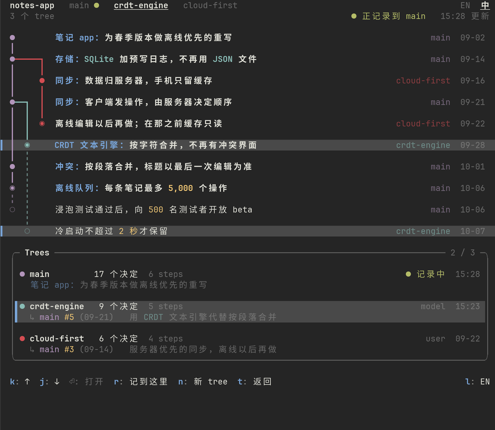
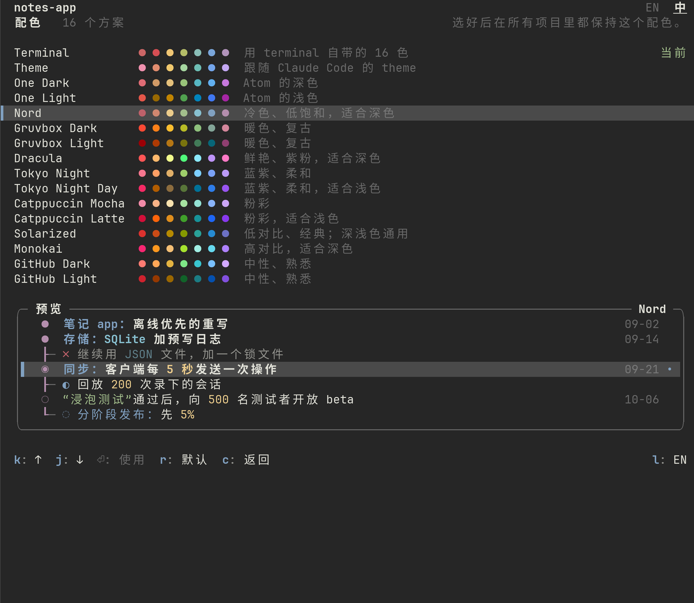

# decision-tree

[English](README.md) | **简体中文**

一个通用的 Claude Code mod：把项目里做过的决定记成一棵树，显示在终端右侧停靠的 pane 里。


*由 pane 自己的排版代码，用一个虚构的示例项目画出。字体和颜色取决于你的终端，图里用的是一种常见的深色主题。*

- **Claude 来记，你说了算。** 决定由 Claude 在你工作时，通过 mod 注册的工具记录；你也可以用命令，或者直接在 pane 里改。
- **一条 rail 加一个 frame。** mainline 画成图的脊柱，试过又放弃的方案挂在它旁边；下面的 frame 把选中那个决定的来龙去脉讲完：rationale、evidence、sources、notes。重要的词（数字、日期、名字、引文）像代码一样上色。
- **多棵 tree。** 可以从当前版本、或任何更早的版本新开一棵 tree 接着往下记（像 git 开 branch），原来那棵不动。用 tab 在各棵 tree 之间切换，Trees 总览把它们画成一张图。见[多棵 tree](#多棵-tree)。
- **English 和中文，随时切换。** 每个决定都有英文版本可读；按一个键（`l`）或点一下 `EN 中`，整个 pane 就切换过去。中文模式下，专业名字和日常工作用词（bug、doc、commit……）仍然是英文。见[语言](#语言)。
- **16 套配色。** 默认用你终端自己的颜色，pane 看起来和终端的其他部分一致；也可以换成 One Dark、Nord、Gruvbox、Dracula、Catppuccin……按 `c`。见[配色](#配色)。
- **记录就在项目里。** 数据是 `.claude/decisions/` 里的纯文本。任何在该项目里启动的 session 读同一份记录、接着往下记；用 git 同步，tree 就跟着你换机器。
- **"Now" 一栏**（可选）放在 tree 上方：由项目自己配置的状态命令（输出 JSON）每 30 秒刷新一次，显示长任务、预计完成时间和下一个关口。
- 不含任何项目名、路径或机器名。凡是和具体项目有关的东西，都放在该项目自己的 `config.json` 里。

**快速开始**

```
/plugin install decision-tree --marketplace xwzhang98/decision-tree
```

然后在任何项目里运行 `/decide init`：Claude 会浏览项目、记下它的起点，pane 随之填起来（用 `/tree` 打开）。只想要一棵空树的话，对 Claude 说"从现在开始记录决定"，或者运行 `/decide start`。详见[安装](#安装)和[开始使用](#开始使用)。

## 目录

1. [前提](#前提)
2. [安装](#安装)
3. [开始使用](#开始使用)
4. [命令](#命令)
5. [界面](#界面)
6. [多棵 tree](#多棵-tree)
7. [语言](#语言)
8. [配色](#配色)
9. ["Now" 一栏和状态命令](#now-一栏和状态命令)
10. [Ghostty 和其他终端](#ghostty-和其他终端)
11. [给模型的工具](#给模型的工具)
12. [数据格式](#数据格式)
13. [需要知道的行为](#需要知道的行为)
14. [开发和测试](#开发和测试)
15. [接入你自己的项目](#接入你自己的项目)
16. [实现取舍与假设](#实现取舍与假设)
17. [第三方声明](#第三方声明)
18. [作者](#作者)
19. [License](#license)

## 前提

- 按 Claude Code **2.1.296** 的 mod API 写成（`claude plugin validate`、`tsc -p`、`claude plugin test` 在这一版上都通过）。mod API 每个版本都会变：换版本后先跑一遍 validate 和 test，见[开发和测试](#开发和测试)。
- 终端用 fullscreen 布局时，pane 停靠在右侧，和 diff 面板以 tab 并存。宽度规则归引擎管。项目已经在记录时，mod **自己**打开 pane，终端至少 144 列宽才画出来（你用 `/tree` 打开过一次之后，110 列就够）；更窄时它先等着，窗口拉宽后再出现。你自己用 `/tree` 或 `/decide` 打开的 pane，从 110 列起停靠在右侧；更窄的终端里，它画在输入框上方（见[需要知道的行为](#需要知道的行为)）。
- 不需要任何外部程序。它运行的外部命令只有 `git rev-parse` 和 `git check-ignore`（找项目根目录、检查 `.gitignore`），以及你批准过的状态命令。
- 它唯一用到网络的地方，是可选的后台翻译：你的决定里还没有另一种语言版本的文字，会用你 session 自己的凭证，发给你 session 自己用的模型。别的东西都不会离开这台机器。`/decide translate off` 可以把它关掉，见[语言](#语言)。

## 安装

### 从 GitHub 装

```
/plugin install decision-tree --marketplace xwzhang98/decision-tree
```

Claude Code 会问 `Add marketplace?`：按 `y`，选 **Install for you (user scope)**，回车。出现 `Installed decision-tree. Plugin is now active.` 就装好了：当前 session 立刻生效，以后在这台机器上启动的每个 session 都会加载它。

在命令行里也可以：

```bash
claude plugin marketplace add xwzhang98/decision-tree
claude plugin install decision-tree@decision-tree --scope user
```

想发布你自己的一份：把这个文件夹作为仓库根目录推上去（`.claude-plugin/marketplace.json` 已经写好），然后用 `/plugin install decision-tree --marketplace <owner>/<repo>`。

### 装到远程服务器（不打断正在跑的 session）

远程服务器上的 session 可能正带着无人值守的长任务队列。**安装和调试都不要重启它们**：另开一个 Claude Code session 来装、来试。已经在跑的 session 不受影响（它们要等你下次重启才会加载这个 mod）。

1. 把整个文件夹拷到服务器上，例如 `~/mods/decision-tree`：

   ```bash
   rsync -a --exclude '.claude-plugin/types' decision-tree/ server:~/mods/decision-tree/
   ```

   （服务器能访问 GitHub 的话，可以不拷文件，直接在那个新 session 里用上面的 GitHub 方式安装。）

2. 在那个新开的 Claude Code session 里输入：

   ```
   /plugin install decision-tree --marketplace ~/mods/decision-tree
   ```

   在 `Add marketplace?` 处按 `y`，选 **Install for you (user scope)**，回车。出现 `Installed decision-tree. Plugin is now active.` 就装好了：当前 session 立刻生效，以后在这台机器上启动的每个 session 都会加载它。

3. 以后改代码：直接编辑 `~/mods/decision-tree`，然后在 session 里运行 `/reload-plugins`。

不在交互界面里的话，用命令行：

```bash
claude plugin marketplace add ~/mods/decision-tree
claude plugin install decision-tree@decision-tree --scope user
```

### 只试一试，不安装

```bash
claude --plugin-dir ~/mods/decision-tree
```

只对这一个 session 生效，改了文件会自动重新加载。

## 开始使用

一个项目默认**不记录**：没有 `.claude/decisions/config.json` 时，mod 不写任何文件，system prompt 里只多一行（大意是"如果用户要求开始记录这个项目的决定……，调用 decision_log_start"），模型也只看得到 `decision_log_start` 这一个工具。

开启记录有三种方式：

- 运行 `/decide init [标题]`：开启记录，**并且**让 Claude 浏览项目、记下起点，见[从项目本身建立起点](#从项目本身建立起点)；
- 在 prompt 里说"从现在开始记录决定"（英文 "start recording decisions from now" 也行），模型会调用 `decision_log_start`；
- 或者自己运行 `/decide start [标题]`。

后两种得到的是一棵空树。

开启之后，mod 会：写下 `config.json` 和一条 `start` event；注册其余六个工具（`decision_record`、`decision_update`、`decision_note`、`decision_tree`、`decision_new_tree`、`decision_use_tree`）；把 system prompt 里那一段换成完整版；由开启记录的这个 session 打开 pane（你用 `/decide start` 开启时，pane 还会拿到键盘；用 `/decide init` 则不会，因为 Claude 马上就开始干活。pane 只有在地方够用时才会画出来，见[前提](#前提)）。其他已经在这个项目里运行的 session，会在 5 秒内发现 `config.json` 出现，同样切到开启状态；它们的终端是 fullscreen 布局、且 `display.autoOpen` 为真时，也会各自打开一次 pane。

暂停和恢复：`/decide pause`、`/decide resume`。暂停期间，模型的写工具会回答"未记录：决定记录已暂停"，system prompt 那一段缩成一行，只说记录已暂停；你自己用命令和在 pane 里手动改，仍然可用。

如果项目的 `.gitignore` 忽略了 `.claude/`，开启记录时会提示"注意：.gitignore 忽略了 .claude/，这些文件不会进 git。"。mod **绝不会改 `.gitignore`**。git 没法在一个被忽略的目录里再放行其中的子路径，所以要让 `decisions/` 进 git，把 `.claude/` 改成：

```
.claude/*
!.claude/decisions/
```

### 从项目本身建立起点

`/decide init [标题]` 之于这个 mod，就像 `/init` 之于 Claude Code：不从一棵空树开始，而是让 Claude 先把项目看一遍，把项目现在的位置记下来。

```
已开始记录 notes-app 的决定（数据在 .claude/decisions/）
已请 Claude 浏览项目并记下起点；记录会陆续出现在 pane 里。
```

1. 记录还没开启时，mod 先把它开启（和 `/decide start` 一样，只是 pane 不拿键盘）。
2. 稍后它把一个任务交给 Claude，就像你自己打字发出的一样：看 README 和 docs、笔记、`CLAUDE.md` / `AGENTS.md`、决定记录（`docs/adr`、`DECISIONS.md`）、changelog、最近 30 个 commit 和 tag、主要的配置和清单文件、代码的目录结构。只是快速看一遍，大约十来次读取。
3. Claude 用 `decision_record` 记下**起点**：mainline 的根（milestone，状态 adopted），说明这个项目是什么、现在到了哪一步，用到的文件作为 `sources`。
4. 然后在它下面，最多再记七条项目里已经明确做出的决定：文件里写明已经定下或正在用的，记 `adopted`；写明被放弃的备选，记 `rejected`；列为下一步或还没定的，记 `planned` 或 `proposed`。每一条都带来源；commit 或文档给出了日期的，带上 `decidedAt`。不编造：文件里看不出来的就不记。
5. 最后用两三句话说明记了什么、哪些看不出来。

留下来的样子大致是这样（虚构的项目，Claude 可能会这样记）：

```
  notes-app                                                                                  EN  中
  6 个决定   mainline 1 step                                                  ● 记录中   15:28 更新

▌ ◉  笔记 app：v1 已上线                                                                    03-14
  ┠─ ✓ 笔记存成磁盘上的 JSON 文件
  ┠─ ✓ 通过 REST 接口同步，每 60 秒轮询一次
  ┠─ ✗ 用 websocket 做实时同步
  ┠─ ○ 为春季版本做离线优先的重写
  ┖─ ◌ 桌面客户端

  ╭─ Details ──────────────────────────────────────────────────────────  ✓ adopted  model  03-14 ─╮
  │                                                                                               │
  │ 笔记 app：v1 已上线                                                                           │
  │                                                                                               │
  │ 手机和网页上的笔记 app，3 月上线。笔记是磁盘上的 JSON 文件，通过 REST 接口同步。              │
  │                                                                                               │
  │ Sources  README.md                                                                            │
  │          CHANGELOG.md                                                                         │
  │                                                                                               │
  ╰───────────────────────────────────────────────────────────────────────────────────────────────╯

  k: ↑  j: ↓  ⏎: 展开  e: 编辑  p: pending  t: 总览  c: 配色  h: 隐藏 rejected  a: 全部       l: EN
```

它不改你项目里的任何文件（`.claude/decisions/` 里的记录除外），不运行项目里的任何代码，不启动任何 job，并且会跳过 `.env` 这类放密钥的文件。它只通过普通的 `decision_record` 工具来写，所以它记下的每一条，都可以像别的 node 一样，在 pane 里编辑、用 `/decide status` 改状态、或用 `/decide retract` 撤回。它是对模型提的一个请求，不是一段程序：记下什么，取决于项目文件里写了什么、模型怎么读它们，所以记完请自己看一遍。读取项目文件走的是你 Claude Code 设置里一贯的权限提示。

`/decide init` 只用来建**空**树。在已经有决定的 tree 里，它会说明这一点然后什么都不做（`/decide new <name> --empty` 可以开一棵空 tree 在里面运行它）；记录处于暂停时，它会请你先 `/decide resume`。这个任务要等 session 空闲后才自己开一个 turn，所以 Claude 正忙时，它会等当前这一轮结束。`display.language` 是 `zh`，或者是 `auto` 且你打过中文时，记录用中文写；是 `en` 时用英文；其余情况用你写作用的语言（Claude 看不出来时用英文）。只要写的不是英文，Claude 还会同时交出每段文字的英文版，这样 pane 马上就能显示英文，见[语言](#语言)。任务的原文在 `lib/init.ts` 里。

## 命令

| 命令 | 作用 |
|---|---|
| `/tree` | 打开 pane（或切到它）并把键盘交给它。屏幕上没有地方放 pane 时，把 tree 以文字形式返回 |
| `/decide init [标题]` | 开启记录，**并且**让 Claude 浏览项目、记下起点，见[从项目本身建立起点](#从项目本身建立起点) |
| `/decide start [标题]` | 手动开启记录，得到一棵空树 |
| `/decide pause`、`/decide resume` | 暂停、恢复 |
| `/decide status <id> <status>` | 改状态，例如 `/decide status replay-200 adopted`。status 可以写成它的 id、英文名或中文名（`采用`、`否决`、`进行中`……） |
| `/decide note <id> <text>` | 加一条 note |
| `/decide add <title> --parent <id> [--status planned]` | 手动加一个 node。还可以带 `--kind decision\|protocol\|design\|milestone`、`--id <slug>`、`--trunk` |
| `/decide retract <id> <reason>` | 撤回记错的记录（和决定被 `withdrawn` 不是一回事） |
| `/decide import <file>` | 批量导入一批 node，见[导入初始数据](#导入初始数据) |
| `/decide new <name> [--at <version>] [--from <tree>] [--title <text>] [--empty] [--stay]` | 新开一棵 tree：它从当前版本（或 `--at` 指定的版本）的一份拷贝开始，项目随即切到它，见[多棵 tree](#多棵-tree) |
| `/decide use <name>` | 切到另一棵 tree（`main` 是第一棵） |
| `/decide tree` | 列出项目的 tree、每棵从哪里开出来、各有多大 |
| `/decide log [N]` | 当前 tree 最近 N 条 event（默认 12，最多 60），带编号：`#N` 就是可以给 `--at` 用的版本 |
| `/decide`（不带参数） | 打开 pane，并开始编辑选中的 node |
| `/decide lang en\|zh\|auto` | 为项目里的所有人固定 pane 的语言，或者回到自动（写进 `config.json`；它同时会丢掉你自己用 `l` 键做的选择），见[语言](#语言) |
| `/decide translate on\|off` | 没有另一种语言版本的文字，要不要由你 session 的模型在后台翻译（写进 `config.json`）；`on` 还会让它在放弃之后重新再试 |
| `/decide colors [name\|reset]` | 配色：不带名字时说明正在用哪一套，`reset` 回到 Terminal。按你个人保存，所有项目通用，见[配色](#配色) |
| `/decide autoopen on\|off` | 记录开启后，pane 要不要自己打开 |

凡是要 `<id>` 的地方，也可以给标题里的一小段，只要它恰好匹配一个 node；匹配到好几个时，命令会把候选的 id 列出来。手写的 event，`actor` 是 `"user"`。命令返回一行回执。三个和 tree 有关的命令还有长写法 `/decide tree new|use|log`（`list` 和 `/decide tree` 一样）；`new` 也可以写成 `fork`、`新建` 或 `新开`，`use` 也可以写成 `switch` 或 `切换`。`/decide colors` 也可以写成 `/decide 配色`。

## 界面

pane 打开时宽 72 列、高 24 行（排版从 16 列起就能工作，会适应它拿到的任何空间）。下面是它在这个尺寸下画出来的样子，以文字形式给出（中文，虚构的示例项目）：

```
  notes-app   main ●   crdt-engine   cloud-first                 EN  中
  17 个决定   mainline 6 steps                    ● 记录中   15:28 更新

  ▲ 上面还有 5 行
  ●  同步：客户端发操作，由服务器决定顺序                       09-21
  ┠─ ✗ CRDT 文本引擎：旧手机上太重
  ┠─ ⊘ 发送前压缩操作
▌ ●  冲突：按段落合并，标题以最后一次编辑为准                   10-01 •
  ┠─ = 合并窗口用 5 秒，不用 10 秒
  ┠─ ✓ 笔记被合并时给出提示条
  ▼ 下面还有 6 行

  ╭─ Details ──────────────────────────────  ✓ adopted  model  10-01 ─╮
  │ 冲突：按段落合并，标题以最后一次编辑为准                          │
  │ 正文按段落合并，标题和标签以最后一次编辑为准；回放 200 次真实编辑 │
  │ 会话后只剩 3 处冲突，都在标题上。                                 │
  │ Rationale  段落是用户理解"我改了哪里"的最小单位，按它合并最不让人 │
  │            意外。CRDT 原型的冷启动慢 0.5 秒，在三年前的手机上更明 │
  │            显，而收益只在多人同时编辑同一段时才有，这个版本没有这 │
  │ …                                                                 │
  ╰───────────────────────────────────────────────────────────────────╯

  k: ↑  j: ↓  ⏎: 展开  e: 编辑  p: pending  t: 总览               l: EN
  o: 下个 tree  c: 配色  h: 隐藏 rejected  a: 全部
```

从上到下：

- **strip（最上面一行）。** 项目名用粗体；项目里有不止一棵 tree 之后，后面跟着每棵 tree 的 tab（见[多棵 tree](#多棵-tree)）：正在看的那棵是粗体加下划线，记录写入的那棵带一个绿色的 `●`。右边，文字还在翻译时有 `◌ 翻译中 14`，最右是语言开关 `EN  中`，当前的语言是粗体加下划线（见[语言](#语言)）。
- **状态行（state line）。** 这棵 tree 有多少个决定、mainline 有多长，是否在记录（`● 记录中`、`● 已暂停`），以及最近一次改动的时间。看的是项目不往里记的 tree 时，改为 `○ 只读   正记录到 main`。pane 窄时，先去掉更新时间，再去掉 mainline。
- **来源行（origin line）**，只在从另一棵 tree 开出来的 tree 上、且从 16 行起才有：`↳ main #5 (09-21)   用 CRDT 文本引擎代替按段落合并`，说明它从哪里开始、这棵 tree 用来做什么。
- **rail。** mainline 画成图的脊柱，一个 step 一行，每个 step 上试过的东西挂在它旁边（见下）。step 右边的日期是它被决定的日子。
- **Details。** 选中那一行的详情，放在一个 frame 里：标题、summary，然后是 *Rationale*、*Evidence*、*Sources*、*Notes*，各有自己的标签。上边框上有一个 chip，写着状态、谁决定的（`user`、`model`、`gate`）和日期。这个 node 取代了别的 node、或被别的 node 取代时，会有一行说明。
- **按键提示（key hints）。** 每个都是一个按钮：按那个键，或者点它。没画出来的键不起作用，所以 pane 窄时，最没用的先去掉（24 行起最多三行，12 行起两行，再矮就一行）。warnings 的数量（比如读不了的 event 文件）只在有的时候出现在最右端；`l` 永远不会被去掉。

pane 是 Claude Code 的一个普通界面：里面所有东西都可以点（行、tab、`EN  中`、按键提示、`▲ 上面还有 … 行`），`↑` `↓` 和 `k` `j` 一样好用。

### rail

| 符号 | 含义 |
|---|---|
| `●` | mainline 的一个 step |
| `◉` | head：已采用（adopted）的最新一个 step，项目现在所在的位置 |
| `○`（暗淡） | 还在前方的 step：planned 或 proposed |
| `┃` 和 `╏` | step 之间的脊柱：通往那里的路已经走完时是实线，通向前方还没到的 step 时是虚线 |
| `┠─` | 一个分支：在这个 step 上试过或定下的东西，按做出决定的先后排列。`┖─` 是最后一个 step 的最后一个分支，脊柱到这里结束 |
| `╰─` | 分支的分支 |
| `•` | 行尾：最近 24 小时内有改动 |
| `+3` | 这一行下面折叠了三行 |
| `▌` | 选中的行（整个 pane 横贯一条色带） |
| `▲ 上面还有 5 行` `▼ 下面还有 6 行` | rail 可以滚动；这两个是翻页用的按钮 |

step 是标了 `trunk` 的 node（mainline）和各个 root；别的 node 都挂在它上面那个 step 下。一个 step 的分支默认是展开的，还没做完（pending）或最近 48 小时内有改动的子分支也是；在选中的行上按 `⏎`，可以展开或收起它下面的东西（`p` 和 `a` 这两个 filter 会把所有东西都展开）。没有 `trunk` node 的 tree 里，root 就是 step。

状态符号和颜色（颜色是主题色；[配色](#配色)可以给它们换色）：

| status | 符号 | ASCII | 颜色 |
|---|---|---|---|
| `adopted` | ✓ | `+` | 绿 |
| `rejected` | ✗ | `x` | 红 |
| `no-diff` | = | `=` | 灰 |
| `in-progress` | ◐ | `~` | 强调色 |
| `planned` | ○ | `o` | 强调色 |
| `proposed` | ◌ | `?` | 强调色，暗淡 |
| `withdrawn` | ⊘ | `/` | 灰，暗淡 |
| `superseded` | ⊘ | `/` | 灰，暗淡 |
| `deferred` | ‖ | `"` | 灰，暗淡 |

已经结束或搁置的决定（rejected、withdrawn、superseded、deferred）整行都画成暗淡的，标题也是。这些名字在 pane 的两种语言里都一样，因为命令吃的就是它们。

重要的词像代码一样上色：同一类词永远是同一种颜色，别的东西不上色：

| 种类 | 例子 | 颜色 |
|---|---|---|
| Topic | 标题里第一个冒号之前的部分（`同步：`），以及 *Sources* 里的文件名 | 蓝 |
| Number | `99.5%`、`5 秒`、`5,000`、`#5` | 黄 |
| Term | `SQLite`、`CRDT`、`proto_b`（全大写、snake_case、camelCase） | 青 |
| Quote | `"我改了哪里"` | 绿 |
| Date | `09-21`、`15:28` | 灰 |

在 Details 里，model 用 Claude 的颜色显示，用户用普通文字颜色。

◐ ○ ◌ ⊘ 以及线条和方块字符（─ ┃ ╭ █ ░ …）在 Unicode 里属于"宽度不明确"（ambiguous width），有些终端把它们画成两列宽。默认按一列计算（Claude Code 自己的布局也是这样）。如果你的终端画得歪了，在 `config.json` 里设 `display.asciiGlyphs: true`，状态符号、rail、frame、各种标记和进度条就全部换成 ASCII（下面是同一个 pane，80 列宽）：

```
  notes-app   main *   crdt-engine   cloud-first                         EN  中
  17 个决定   mainline 6 steps                            * 记录中   15:28 更新

  ^ 上面还有 4 行
  |- x 继续用 JSON 文件，加一个锁文件
  *  同步：客户端发操作，由服务器决定顺序                               09-21
  |- x CRDT 文本引擎：旧手机上太重
  |- / 发送前压缩操作
> *  冲突：按段落合并，标题以最后一次编辑为准                           10-01 *
  |- = 合并窗口用 5 秒，不用 10 秒
  |- + 笔记被合并时给出提示条
  |- ~ 把录下的 200 次编辑会话回放给合并逻辑                                  *
  v 下面还有 5 行

  +- Details --------------------------------------  + adopted  model  10-01 -+
  | 冲突：按段落合并，标题以最后一次编辑为准                                  |
  | 正文按段落合并，标题和标签以最后一次编辑为准；回放 200 次真实编辑会话后只 |
  | 剩 3 处冲突，都在标题上。                                                 |
  | Rationale  段落是用户理解"我改了哪里"的最小单位，按它合并最不让人意外。   |
  |            CRDT 原型的冷启动慢 0.5 秒，在三年前的手机上更明显，而收益只在 |
  |            多人同时编辑同一段时才有，这个版本没有这个场景。               |
  | Evidence   按段落合并（200 次会话）  剩 3 处，都在标题  replay_a          |
  |            CRDT 原型                 冷启动 2.4 秒，对比 1.9 秒  proto_b  |
  | Sources    docs/adr/0004-sync.md                                          |
  |            docs/design/merge-rules.md                                     |
  | …                                                                         |
  +---------------------------------------------------------------------------+

  k: up  j: down  Enter: 展开  e: 编辑  p: pending  t: 总览               l: EN
  o: 下个 tree  c: 配色  h: 隐藏 rejected  a: 全部
```

Ghostty 的情况见[终端那一节](#ghostty-和其他终端)。

### 按键

它们在 pane 拿着键盘时才起作用：`/tree`（或者 `ctrl+x` 再按 `Tab`）把键盘交给 pane，`Esc` 把键盘还给输入框。

| 键 | 作用 |
|---|---|
| `k` `j`（或 `↑` `↓`） | 移动选择 |
| `⏎` | 在选中的行上再按一次，展开或收起它下面的东西 |
| `e` | 编辑选中的 node：它的状态（九种之一）和一行 summary；保存时写一条 `update` event。只能用在正在记录的那棵 tree 里，并且屏幕上要有文本框 |
| `p` | 只看 pending（planned、proposed、in progress）；再按一次回去 |
| `h` | 隐藏 rejected 和 withdrawn；再按一次回去 |
| `a` | 显示全部，包括 retracted 的记录；再按一次回去 |
| `s` | 显示或隐藏 "Now" 块（项目有 status 命令时才有） |
| `t` | Trees 总览，见[多棵 tree](#多棵-tree) |
| `o` | 去看下一棵 tree（项目有不止一棵时才有） |
| `c` | 配色，见[配色](#配色) |
| `l` | 切换 pane 的语言 |
| `Esc` | 把键盘还给输入框 |

filter 开着时，状态行下面有一行说明（`只看 pending`、`rejected 已隐藏`、`显示全部`）。

### 地方不够时

从 20 行起，用空行把各部分隔开；从 24 行起，rail 的 step 之间多一行脊柱；从 26 行起，Details 也有了喘气的空间，每一项都只在整体仍然放得下时才加。pane 矮的时候，先给 rail 一个有用的高度（大约 pane 的三分之一，4 到 12 行），所以 Details 要被裁短来腾地方，最少裁到 6 行；还不够的话，先去掉 "Now" 块，然后 Details 再缩，最后整个去掉。底部的按键提示永远不让位。有一个例外：等你批准的 status 命令优先于 Details。如果连完整的命令加上按钮都放不下，就不画按钮，"Now" 块只显示一行 `有一条 status 命令在等你确认；把 pane 拉大后才看得全。`；pane 变大后，命令和**允许运行**按钮才会出现。

所有截断和折行都按**显示宽度**来做（CJK 和全角字符占两列，组合符号占零列，宽度不明确的字符占一列），用的是 pane 实际能画的列数。标题用 `…` 截断；tab 先缩短自己，再让位给正在看的那个 tab（把它的邻居去掉）；Details 和按键提示按它们拿到的宽度折行。

## 多棵 tree

一个项目默认只有一棵 tree，叫 `main`。想换一条思路试试（"前提不变，换个做法"），又不想弄乱已有的记录时，就新开一棵 tree。它从某棵 tree 的某个 **version** 的一份拷贝开始；之后记下的一切只进新 tree，原来那棵保持原样，随时可以切回去。这和 git 的 branch 是同一个思路。

### tab

项目里有不止一棵 tree 之后，strip 上每棵 tree 都有一个 tab。点 tab，或按 `o`，就可以去看那棵 tree。看的那棵不一定是记录写入的那棵：绿色的 `●` 标出正在记录的 tree，其他的 tree 都是只读的（状态行写着 `○ 只读   正记录到 main`，不提供 `e`，不带参数的 `/decide` 会告诉你按 `t`、选中那棵 tree、再按 `r`，才能记到它里面）。下面是 `crdt-engine` 这棵 tree，它从 `main` 的 Sync 那个 step 开出来，这是记录仍然写向 `main` 时看到的样子：

```
  notes-app   main ●   crdt-engine   cloud-first                                             EN  中
  9 个决定   mainline 5 steps                                   ○ 只读   正记录到 main   15:28 更新
  ↳ main #5 (09-21)   用 CRDT 文本引擎代替按段落合并

  ●  笔记 app：为春季版本做离线优先的重写                                                   09-02
  ┃
  ●  存储：SQLite 加预写日志，不再用 JSON 文件                                              09-14
  ┠─ ✗ 继续用 JSON 文件，加一个锁文件
  ┃
  ●  同步：客户端发操作，由服务器决定顺序                                                   09-21
  ┃
  ◉  CRDT 文本引擎：按字符合并，不再有冲突界面                                              09-28
  ┠─ ✓ 墓碑记录：每周压缩一次
▌ ┠─ ◐ 在三台旧手机上做原型                                                                       •
  ┃  ╰─ ◌ 备选：超过 50 KB 的笔记退回按段落合并                                                   •
  ╏
  ○  冷启动不超过 2 秒才保留                                                                10-07

  ╭─ Details ──────────────────────────────────────────────────────  ◐ in progress  model  10-07 ─╮
  │                                                                                               │
  │ 在三台旧手机上做原型                                                                          │
  │                                                                                               │
  │ 原型在三台三年前的旧手机上跑：CRDT 引擎冷启动 2.4 秒，按段落合并是 1.9 秒。                   │
  │                                                                                               │
  │ Rationale  按字符合并可以去掉冲突界面，但前提是旧手机的冷启动不超过 2 秒预算，目前的数字还没  │
  │            达标。每周压缩墓碑记录已经做了，下一步是精简启动时加载的索引。                     │
  │ Evidence   CRDT 引擎冷启动   3 台手机 2.4 秒  proto_c                                         │
  │            按段落合并冷启动  1.9 秒  proto_b                                                  │
  │ Sources    docs/design/crdt-prototype.md                                                      │
  │            reports/crdt_cold_start_20261007/RESULTS.md                                        │
  │ Notes      10-07 model  下一个实验是精简索引。                                                │
  │                                                                                               │
  ╰───────────────────────────────────────────────────────────────────────────────────────────────╯

  k: ↑  j: ↓  ⏎: 展开  p: pending  t: 总览  o: 下个 tree  c: 配色  h: 隐藏 rejected  a: 全部  l: EN
```

### Trees 总览

`t` 打开项目所有 tree 的总览（再按一次 `t` 回来）：



```
  notes-app   main ●   crdt-engine   cloud-first                                             EN  中
  3 个 tree                                                            ● 正记录到 main   15:28 更新

  ●        笔记 app：为春季版本做离线优先的重写                                        main  09-02
  ┃
  ●━━━━━┓  存储：SQLite 加预写日志，不再用 JSON 文件                                   main  09-14
  ┃     ┃
  ┃     ●  同步：数据归服务器，手机只留缓存                                     cloud-first  09-16
  ┃     ┃
  ●━━┓  ┃  同步：客户端发操作，由服务器决定顺序                                        main  09-21
  ┃  ┃  ┃
  ┃  ┃  ◉  离线编辑以后再做；在那之前缓存只读                                   cloud-first  09-22
  ┃  ┃
▌ ┃  ◉     CRDT 文本引擎：按字符合并，不再有冲突界面                            crdt-engine  09-28
  ┃  ╏
  ●  ╏     冲突：按段落合并，标题以最后一次编辑为准                                    main  10-01
  ┃  ╏
  ◉  ╏     离线队列：每条笔记最多 5,000 个操作                                         main  10-06
  ╏  ╏
  ○  ╏     浸泡测试通过后，向 500 名测试者开放 beta                                    main  10-06
     ╏
▌    ○     冷启动不超过 2 秒才保留                                              crdt-engine  10-07

  ╭─ Trees ─────────────────────────────────────────────────────────────────────────────── 2 / 3 ─╮
  │                                                                                               │
  │ ● main         17 个决定  6 steps                                             ● 记录中  15:28 │
  │   笔记 app：为春季版本做离线优先的重写                                                        │
  │                                                                                               │
  │▌● crdt-engine   9 个决定  5 steps                                                model  15:23 │
  │▌  ↳ main #5 (09-21)   用 CRDT 文本引擎代替按段落合并                                          │
  │                                                                                               │
  │ ● cloud-first   6 个决定  4 steps                                                 user  09-22 │
  │   ↳ main #3 (09-14)   服务器优先的同步，离线以后再做                                          │
  ╰───────────────────────────────────────────────────────────────────────────────────────────────╯

  k: ↑  j: ↓  ⏎: 打开  r: 记到这里  n: 新 tree  t: 返回                                       l: EN
```

- **图（graph）**按做出决定的先后，画出每棵 tree 的每个 step；每棵 tree 一条 lane，各有自己的颜色。一条粗线（`●━━┓`）在新 tree 开出来的那个 step，从它的来源 tree 的 lane 上分出去。作为所在 tree 的 head 的 step 是 `◉`，还在前方的 step 是 `○`，通向它们的脊柱是虚线。高亮的那棵 tree 自己的 step 带 `▌`。
- **列表（list）**每棵 tree 一项：名字、有多少个决定和 step、最后是谁写的（`model` 或 `user`）和什么时候；下面一行是它从哪里开出来、用来做什么。`● 记录中` 标出项目正在往里记的那棵 tree。
- 用 `k` `j`（或点击）选一棵 tree，`⏎` 就去看它（它成为 pane 显示的 tree；除非是正在记录的那棵，否则只读），`r` 让它成为项目记录写入的 tree，`n` 打开新建 tree 的表单。

表单要填三项，并提供 `⏎: 创建`：

```
  新 tree   基于 main
    Name    sync-v2
    Version #5
    Title   用来做什么（可不填）
    之后你会记到它里面。
    [ 创建 ]  取消
```

*Name* 可以写字母、数字和连字符。*Version* 留空表示 tree 现在的样子，也可以是[怎么写 version](#怎么写-version)里的任何一种写法（`#5`、`09-21`、node id）。*Title* 是给人看的一行，说这棵 tree 用来做什么。创建 tree 会把项目的记录切到它；想开一棵但不切过去，用 `/decide new … --stay`。在没有文本框的界面（手机）上，表单会告诉你改用 `/decide tree new <name>`。

tree 很多时，图和列表会跟着高亮一起滚动（`▲ 上面还有 … 行`、`▼ 下面还有 … 行`），pane 窄时 lane 之间会靠得更近。图最多画 40 棵 tree。

### 新开一棵 tree

```
/decide log                                          # 先看一下 event 的编号
/decide new crdt-engine                              # base = 当前版本
/decide new crdt-engine --at #5                      # base = 第 5 个 event 之后的状态
/decide new crdt-engine --at sqlite-wal              # base = 记下 sqlite-wal 那一刻的状态
/decide new crdt-engine --at "2026-09-21 12:00"      # base = 那个时间点的状态
/decide new crdt-engine --title "用 CRDT 文本引擎代替按段落合并"
/decide tree                                         # 列出所有 tree
/decide use main                                     # 切回 main
```

名字只能用字母、数字和连字符；更长的说明写在 `--title` 里。下面是在示例项目上真实运行得到的回执（命令就是上面那些，数据是虚构的）：

```
$ /decide log 8
Tree「main」：共 19 个 event，最近 8 个（--at 里写 #N）：
#12  10-05 12:00  model   add replay-200 "把录下的 200 次编辑会话回放给合并逻辑"
#13  10-06 12:00  model   add title-conflicts "标题冲突：两个版本都显示，让用户自己选"
#14  10-06 12:00  user    add offline-queue "离线队列：每条笔记最多 5,000 个操作"
#15  10-06 12:00  model   add beta-500 "浸泡测试通过后，向 500 名测试者开放 beta"
#16  10-06 12:00  model   add soak-test "浸泡测试：三台旧手机，离线一周"
#17  10-06 12:00  model   add staged-rollout "分阶段发布：先 5%，再四分之一，最后全部"
#18  10-08 12:00  user    add desktop-later "桌面客户端：春季版本之后再做"
#19  10-13 12:00  user    add release-bar "发布门槛：无崩溃会话占比高于 99.5%"

$ /decide new crdt-engine --at #5 --title "用 CRDT 文本引擎代替按段落合并"
已新开 tree「crdt-engine」，基于 main 的 #5（09-21 12:00）：4 个 node。现在记录到这里。

$ /decide use main
现在记录到 tree「main」。

$ /decide new cloud-first --at sqlite-wal --stay --title "服务器优先的同步，离线以后再做"
已新开 tree「cloud-first」，基于 main 的 #3（09-14 12:00）：2 个 node。仍在记录到「main」；/decide tree use cloud-first 可以切换。

$ /decide tree
这个项目的 tree（正在记录到「main」）：
* main         17 个 node，19 个 event
  cloud-first  基于 main 的 #3（09-14 12:00） · 2 个 node，3 个 event · "服务器优先的同步，离线以后再做"
  crdt-engine  基于 main 的 #5（09-21 12:00） · 4 个 node，5 个 event · "用 CRDT 文本引擎代替按段落合并"
```

（`/decide tree` 里带标记的那棵是记录写入的 tree；你看到的就是文本本身，行首是 `*`。在对话里，回执会被当作 markdown 处理，行首的 `*` 会被画成 `-`，意思不变；模型的 `decision_tree` 工具收到的是 `*`。上面的图是几周之后截的，那时这些 tree 已经长大了。）

会被拒绝的情况，每种一句话，什么都不写：

```
$ /decide new cloud-first --at 09-30
tree「cloud-first」已经存在；换个名字，或用 /decide tree use cloud-first 切过去

$ /decide new main
"main" 是项目的第一棵 tree，请换个名字

$ /decide new later --at #40
没有 #40 这个 version：「main」一共 19 个 event（#1 到 #19）

$ /decide new later --at nowhere-like-this
看不出 "nowhere-like-this" 是哪个 version；可以写 current、#N（/decide tree log 里有）、日期时间如 2026-10-08 17:44，或 node id
```

### 选项

| 选项 | 含义 |
|---|---|
| `--at <version>`（也可写 `--version`） | 拷贝哪个 version，见下表。不写就是当前版本 |
| `--from <tree>` | 拷贝另一棵 tree，而不是你现在所在的这棵（`/decide new cloud-first --from main --at #3`） |
| `--title <text>` | 对这棵 tree 的一句给人看的描述（最多 120 个字符），显示在 pane 里和 `/decide tree` 里。名字里放不下的东西都写在这里 |
| `--empty` | 一棵空白的 tree：不拷贝任何 event，里面只有一条 `start` |
| `--stay` | 开出来，但不切过去：项目继续往原来那棵 tree 里记；以后用 `/decide use <name>` 再切 |

名字是 2–32 个小写字母、数字和连字符。你写了大写字母、空格或标点、而把它们换成连字符后就是合法名字的，会被自动换掉（`Crdt Engine` 变成 `crdt-engine`）；`main` 已经被占用；无法变成合法名字的（比如全是中文），会被拒绝，并提示把它写进 `--title`。名字已经存在、tree 不存在、version 看不懂，各用一句话拒绝，什么都不写。

### 怎么写 version

一棵 tree 的历史就是它按文件名顺序排列的 event 文件（见[数据格式](#数据格式)），**version 就是前 N 个 event**：

| 写法 | 含义 |
|---|---|
| 什么都不写，或 `current`、`now`、`head`、`latest`、`当前`、`最新` | 到现在为止记下的全部 |
| `#5` | 前 5 个 event。`/decide log` 给每个 event 编号；`fork` 标记不占编号 |
| `2026-10-08 17:44`、`10-08 17:44`、`10-08`、`17:44`、`10月8日 17:44` | 到那个时间为止的全部。用本地时区；精确到分钟的时间算到那一分钟的最后一刻，只写日期算到那一天结束；不写年份就用今年（如果那样会落在未来，就用去年），只写时间就用今天（如果会落在未来，就用昨天） |
| `20261008T214400Z` | UTC 时间戳，就是 event 文件名开头的那种；写开头的一部分就够 |
| `sqlite-wal`、`write-ahead log` | 记下那个 node 的那一刻：可以是 node id，或者标题里恰好匹配一个 node 的一小段（匹配到好几个会被拒绝，并列出候选） |
| `node:sqlite-wal` | 同上；node 的 id 恰好长得像上面某种写法时，加 `node:` 前缀 |

早于这棵 tree 第一个 event 的时间会被拒绝，提示里会说第一个 event 是什么时候；超出 event 总数的 `#N` 也一样。

### 数据怎么存

- `main` 仍然放在 `.claude/decisions/` 下的 `events/` 和 `tree.json` 里，和只有一棵 tree 的时候完全一样。其他 tree 放在 `.claude/decisions/trees/<name>/` 下，各有自己的 `events/` 和 `tree.json`。整个项目只有一个 `config.json` 和一个 `i18n/` 文件夹。
- 新开一棵 tree，就是把 base version 之前的 event 文件**逐字节、用同样的文件名**拷进新 tree 的 `events/`，**最后**再写一条 `fork` event，记下它是从哪棵 tree 的哪个 event 开出来的。保留文件名，就保住了 event 在新 tree 里的顺序。操作的顺序是刻意的：有了 `fork` event，一棵 tree 才算开好；拷到一半被中断，会留下一个没有 `fork` event 的文件夹，它永远不会被切过去（`/decide tree` 把它标成"没做完的复制"）。
- 再次开同一个名字：如果上次留下的文件都在这次要拷的范围之内，就接着把活干完；如果文件夹里有这次不会拷的文件，就拒绝，并说有几个。mod 从不替你删文件：请自己去看那个文件夹、自己处理，或者换一个名字。
- 可以从一棵本身也是 fork 的 tree 再开新 tree：新 tree 只带一条 `fork` event，记下它直接的来源。
- 新 tree 里发生的一切（模型的工具、你的命令、在 pane 里手动改）都只写进新 tree；原来那棵一个文件都不会多。
- 文字的翻译是共享的：从另一棵开出来的 tree 不需要拷贝它们（见[语言](#语言)）。

### 切换会影响谁

记录当前写入哪棵 tree，写在 `config.json` 的一个可选键 `"tree": "<name>"` 里（没有这个键就是 `main`）。**整个项目只有一个指针**，不是每个 session 一个。在 pane 里看哪棵 tree 则是另一回事：那只是你自己的，对别人没有任何影响。

- 你在一个 session 里运行 `/decide new`、`/decide use` 或按 `r` 之后，这个项目里正在运行的其他 session 都会跟着切：最迟在下一次 5 秒的轮询时，并带一条通知（"现在记录到 tree「crdt-engine」（项目已切换到它）。"）。你做切换的那个 session 只收到回执，不收这条通知。
- 模型的写工具和读工具，以及你敲的写命令（`add`、`status`、`note`、`retract`、`import`、`new`、`use`），动手之前都会先读一遍 `config.json`，所以另一个 session 刚做的切换会立刻生效；不会出现这个 session 还往旧 tree 里写的空窗。（在 pane 里手动改，写进的是 pane 正在显示的那棵 tree：它改的就是你眼前的那个 node。）
- 这也包括无人值守的 session（比如远程服务器上长时间运行的那种）：一旦你切换，它们之后记下的决定就进新 tree。不想这样的话，先 `/decide pause`，或者用 `--stay` 来开 tree。
- 如果 `config.json` 指向一棵这台机器上不存在的 tree（比如 `config.json` 通过 git 先到了、event 文件还没到），session 会留在当前这棵 tree 上，说一次，等 event 文件到了再自己切过去。
- 如果同一个 tree 名在两台机器上各开了一次，git 会把它们合并进同一个文件夹（拷出来的文件名和内容都相同，所以不会冲突）。在不同机器上开 tree 请用不同的名字，或者先 `git pull`。

### 模型和这个功能

模型有 `decision_new_tree` 和 `decision_use_tree`，`decision_tree` 也可以列出所有 tree 并显示 event 编号（见[给模型的工具](#给模型的工具)）。工具的描述里写明：只有你要求时，它才会开或切换 tree，不会自己动手。在 `main` 以外的 tree 里，system prompt 那一段多一行 `Current tree: crdt-engine (from main at #5 (09-21 12:00)). …`，让模型知道自己在往哪棵 tree 里记；下面列出的最近 node 也是那棵 tree 的。你切换 tree 时，这一段会立刻重写，不用等下一个 turn。

### 暂停时，或还没开始记录时

- 暂停时你仍然可以开 tree、切 tree（这些是你自己的动作）。回执末尾会加上"记录现在是暂停的；/decide resume 可以恢复。"，之后的决定不会被记录；模型的 `decision_new_tree` 和 `decision_use_tree` 和它别的写工具一样被拦住。
- 项目还没开始记录时没有东西可拷，命令会请你先运行 `/decide start`。

## 语言

pane 可以用英文或中文显示，随时可以切换：按 `l`，或者点 strip 右边的 `EN` 或 `中`。这个切换只属于你自己（它按项目存在你的 Claude Code store 里，不碰项目本身），屏幕上的一切会立刻跟着变。下面是第一张图里的那个 pane，用英文显示：


- **英文永远都在。** 每个决定里的每一段文字都可以用英文读。模型用中文记东西时，会把英文版本一起交上来；其他没有英文版本的（比如你用中文手动加的 node），会在后台翻译。
- **中文在你用中文读的时候才生成。** 用英文写下的文字，在 pane 用中文显示的时候才会得到它的中文版本。
- **专业名字和日常工作用词，在中文里也保持英文。** 在 pane 的固定文字和每一份翻译里：工具、库、模型、数据集的名字（SQLite、Redis、GPU、API、git），代码、文件名和 run 的名字，id，数字和单位，以及中文的工程师或研究者本来就用英文说的那些词（bug、doc、commit、branch、merge、log、config、prompt、pane、tree、node、run、seed、baseline、checkpoint、benchmark、metric、loss、deploy、rollback、cache、timeout、token、schema、review、release、retry、sync、fallback……）。只有把它们连起来的词是中文。

中文 pane 的固定文字，和英文 pane 对照：

| 英文 pane | 中文 pane |
|---|---|
| `17 decisions   mainline 6 steps` | `17 个决定   mainline 6 steps` |
| `● recording   updated 15:28` | `● 记录中   15:28 更新` |
| `▲ 2 more above` | `▲ 上面还有 2 行` |
| `⏎: expand  e: edit  c: colors` | `⏎: 展开  e: 编辑  c: 配色` |
| `h: hide rejected  p: pending` | `h: 隐藏 rejected  p: pending` |
| `adopted`、`in progress` 等各种 status，`Details`、`Rationale`、`Evidence`、`Sources`、`Notes` | 一样 |

### pane 用哪种语言打开

按这个顺序，第一条适用的算数：

1. **你自己选的**：用 `l` 或语言开关选的。
2. **`config.json` 里的 `display.language`**，当它是 `"zh"` 或 `"en"` 时。它是项目的设置，对所有没有自己选过的人生效。`/decide lang zh` 或 `/decide lang en` 设置它，同时丢掉你用 `l` 做的选择，这样你敲什么就是什么；`/decide lang auto` 回到下一条规则。
3. **`auto`：你写作用的语言。** 由你最近一次输入决定：含有中文字符就是中文；至少有 6 个拉丁字母且没有中文就是英文；以 `/` 开头的输入和太短的输入不改变语言。只有你自己的话才算：来自通知、定时任务、别的 session 或别的 plugin 的 prompt（`/decide init` 交给 Claude 的那个任务也算）说明不了你写作用的是什么语言。结果按项目存在 `$.store` 里；下次打开这个项目时先用上一次的结果，什么都没有就是英文。

模型写的标题、summary 和 rationale 跟随你写作用的语言。模型看到的 system prompt 那一段是英文的（读它的是模型），里面写明了这条规则。

### 文字怎么翻译

一个决定的文字只记一次，用你工作用的语言，event 文件里的任何东西都不会改。同一段文字用另一种语言读起来是什么样，单独存放在项目的**翻译记忆（translation memory）**里：`.claude/decisions/i18n/*.json`。

- **谁来翻译。** 用中文记一段文字的模型，会在同一次调用里交上英文版本（工具的 `en` 参数，见[给模型的工具](#给模型的工具)）。其他的一切都在后台请一个小而快的模型（`haiku`）来做，走的是你 session 自己的模型通道：缺版本的那些决定的文字，会用你自己的凭证发给模型 API，别的东西都不会发。一次请求最多带 12 段文字。中文文字总会有英文版本；英文文字只在 pane 用中文显示时才得到中文版本。技术名词保持原样。
- **在译文到来之前**，文字按原样显示，灰色，标题后面带一个小标记：用中文写的是 `中`，用英文写的是 `EN`。译文在路上时，strip 上显示 `◌ 翻译中 14`，pane 从不等它们：

```
  notes-app   main ●   crdt-engine   cloud-first                               ◌ 翻译中 14   EN  中
  17 个决定   mainline 6 steps                                                ● 记录中   15:28 更新

  ▲ 上面还有 4 行
  ┠─ ✗ Keep JSON files and add a lock file EN
  ●  Sync: clients send operations, the server decides their order EN                       09-21
  ┠─ ✗ CRDT text engine: too heavy for older phones EN
  ┠─ ⊘ Compress operations before sending EN
▌ ●  Conflicts: merge by paragraph, last edit wins for titles EN                            10-01 •
  ┠─ = Merge window of 5 s instead of 10 s EN
  ┠─ ✓ Show a banner when a note was merged EN
  ┠─ ◐ Replay 200 recorded edit sessions through the merge EN                                     •
  ▼ 下面还有 5 行
```

- **存在哪里。** 每一批是 `.claude/decisions/i18n/` 里的一个新文件，写一次、永不修改，文件名像 event 文件一样（时间、session、序号），所以 session 之间、机器之间不会冲突，git 也能合并它们。这个文件夹属于项目，不属于某棵 tree：从另一棵开出来的 tree 什么都不用拷。把它和 `.claude/decisions/` 的其余部分一起 commit，队友（或你的另一台机器）就读到同样的翻译，不用再问一遍。旧版本的 mod 会忽略这个文件夹。
- **出问题时。** 请求失败的话，30 秒后重试，然后 2 分钟，然后 10 分钟；连续失败三次（或者一开始就知道做不了：没有额度、模型不被允许）之后，pane 会告诉你一次，然后不再假装在翻译。模型两次都答得不好的文字就不管它了。`/decide translate on` 让它从头再试。记录暂停期间翻译照常进行；它从不写 event。
- **关掉它：** `/decide translate off`（或在 `config.json` 的 `display` 下写 `"translate": false`）。之后就不会再去问模型，只显示每个决定自带的英文版本；其余的保持写下时的语言，带着它的标记。

一个翻译文件长这样（`via` 说明是谁做的：`tool` 是记录的模型，`translator` 是后台任务）：

```json
{
  "v": 1,
  "ts": "2026-10-13T11:42:09.514-04:00",
  "session": "a1b2c3",
  "actor": "model",
  "via": "tool",
  "lang": "en",
  "pairs": [
    { "from": "冲突：按段落合并，标题以最后一次编辑为准", "to": "Conflicts: merge by paragraph, last edit wins for titles" }
  ]
}
```

文件按文件名顺序读取，同一段文字后来的那一对胜出；一个文件最多 100 对。查找是按文字原样查的，所以改了一个决定，只是产生一段新的文字，在译文到来之前没有翻译。

## 配色



按 `c`（或运行 `/decide colors`）选 pane 的配色。移动高亮就是试色：整个 pane 用它重画，列表下面有一小块 tree 的样子。`⏎`（或点高亮的那套方案）确定，`r` 回到默认，`c` 保持原样退出。你的选择**在每个项目里**都保持不变：它属于你，不属于项目，存在你的 Claude Code store 里。

```
  notes-app                                                                                  EN  中
  配色   16 个方案                                               选好后在所有项目里都保持这个配色。

  Terminal          ● ● ● ● ● ● ●  用 terminal 自带的 16 色                                    当前
  Theme             ● ● ● ● ● ● ●  跟随 Claude Code 的 theme
  One Dark          ● ● ● ● ● ● ●  Atom 的深色
  One Light         ● ● ● ● ● ● ●  Atom 的浅色
▌ Nord              ● ● ● ● ● ● ●  冷色、低饱和，适合深色
  Gruvbox Dark      ● ● ● ● ● ● ●  暖色、复古
  Gruvbox Light     ● ● ● ● ● ● ●  暖色、复古
  Dracula           ● ● ● ● ● ● ●  鲜艳、紫粉，适合深色
  Tokyo Night       ● ● ● ● ● ● ●  蓝紫、柔和
  Tokyo Night Day   ● ● ● ● ● ● ●  蓝紫、柔和，适合浅色
  Catppuccin Mocha  ● ● ● ● ● ● ●  粉彩
  Catppuccin Latte  ● ● ● ● ● ● ●  粉彩，适合浅色
  Solarized         ● ● ● ● ● ● ●  低对比、经典；深浅色通用
  Monokai           ● ● ● ● ● ● ●  高对比，适合深色
  GitHub Dark       ● ● ● ● ● ● ●  中性、熟悉
  GitHub Light      ● ● ● ● ● ● ●  中性、熟悉

  ╭─ 预览 ───────────────────────────────────────────────────────────────────────────────── Nord ─╮
  │   ●  笔记 app：离线优先的重写                                                         09-02   │
  │   ●  存储：SQLite 加预写日志                                                          09-14   │
  │   ┠─ ✗ 继续用 JSON 文件，加一个锁文件                                                         │
  │▌  ◉  同步：客户端每 5 秒发送一次操作                                                  09-21 • │
  │   ┠─ ◐ 回放 200 次录下的会话                                                                  │
  │   ○  “浸泡测试”通过后，向 500 名测试者开放 beta                                       10-06   │
  │   ┖─ ◌ 分阶段发布：先 5%                                                                      │
  ╰───────────────────────────────────────────────────────────────────────────────────────────────╯

  k: ↑  j: ↓  ⏎: 使用  r: 默认  c: 返回                                                       l: EN
```

- **Terminal**（默认）用你终端自己主题的 16 种颜色来画，所以 pane 看起来和终端的其他部分一致：它的绿就是你终端里的那个绿。在不是终端的界面（桌面 app、编辑器、手机）上，没有终端的调色板可跟，就按 **Theme** 来画。
- **Theme** 跟随 Claude Code 自己主题的颜色。
- 其他的是固定调色板，取自大家在编辑器里熟悉的主题：One Dark、One Light、Nord、Gruvbox Dark 和 Light、Dracula、Tokyo Night 和 Tokyo Night Day、Catppuccin Mocha 和 Latte、Solarized、Monokai、GitHub Dark 和 Light。mod 没法问你的终端背景是深色还是浅色，所以深色和浅色版本是分开的条目：选一个在你终端里看着舒服的。

一套方案给 pane 七种强调色（红、橙、黄、绿、青、蓝、紫）。它们是状态、mainline 和各棵 tree 的 lane、上色的词和各种标记的颜色；文字、灰色和选中的色带仍然是你终端的。`/decide colors` 说明正在用哪一套，`/decide colors nord`（名字和选择器里一样，大小写都行）设一套，`/decide colors reset` 回到 Terminal。这些颜色来自开源主题，出处见[第三方声明](#第三方声明)。

## "Now" 一栏和状态命令

在 `config.json` 里设 `status.argv`，mod 就会在项目根目录下运行它、读 stdout 上的 JSON、每 `intervalSec` 秒刷新一次（默认 30），并把结果画在 tree 上方：

```
  ╭─ Now ───────────────────────────────────────────────────────────────╮
  │ ALPHA    sync-bench s0  ████████░░  1700/2000  约 18:40  warming up │
  │ BRAVO    merge-eval s1  █░░░░░░░░░   210/2000  约 07:25             │
  │ CHARLIE  queue-soak s0  idle                                        │
  │ 下一步  restore-test s1（约 05:05）                                 │
  │ ! CHARLIE is idle                                                   │
  ╰─────────────────────────────────────────────────────────────────────╯
```

### 输出约定

```json
{
  "updatedAt": "2026-10-13T11:20:00-04:00",
  "lanes": [
    { "name": "ALPHA",   "run": "sync-bench s0", "state": "running", "step": 1700, "total": 2000, "eta": "18:40", "note": "warming up" },
    { "name": "BRAVO",   "run": "merge-eval s1", "state": "running", "step": 210,  "total": 2000, "eta": "07:25" },
    { "name": "CHARLIE", "run": "queue-soak s0", "state": "idle" }
  ],
  "next": [ { "text": "restore-test s1", "eta": "05:05" } ],
  "warnings": [ "CHARLIE is idle" ]
}
```

- `state` 是 `running`、`queued`、`done`、`failed`、`idle` 之一；`step`/`total`、`eta`、`note` 和 `run` 都可以省略。
- 进度条宽 10 格，用 `█` 和 `░` 画（ASCII 模式下用 `#` 和 `.`）。
- 命令失败时（退出码非零、超时、输出不是合法 JSON），保留最后一份好数据并标上"stale N min"，错误的第一行显示在它下面。

### 安全：第一次会先问你

status 命令是一条任意的 shell 命令。在一个项目里第一次运行之前，"Now" 块会显示 argv 和一个**允许运行**按钮，你确认之后才会运行：

```
  ╭─ Now ─────────────────────────────────────────────────────────────────────────────────────────╮
  │ status 命令想在这个项目里运行：                                                               │
  │   bash scripts/status.sh                                                                      │
  │ 它在你的机器上、项目文件夹里运行；pane 打开期间每 30 秒一次。                                 │
  │ [ 允许运行 ]                                                                                  │
  ╰───────────────────────────────────────────────────────────────────────────────────────────────╯
```

确认的记录是"项目根 + argv"的哈希，存在 `$.store` 里（每台机器各有各的；它不会进 git）。argv 一改就会重新问。所以别人 clone 下来的项目，永远不会运行一条你没看过的命令。

- **批准的是命令行，不是脚本的内容。** `["bash", "scripts/decision_status.sh"]` 被批准之后，脚本文件以后再变（比如 `git pull` 带来了别人的新版本）不会再问；这和你在自己的 shell 里运行那个脚本是同一种信任。
- **你看到的就是将要运行的。** pane 一个词一个词地显示 argv。带空格或 shell 特殊字符的词会加上单引号（开头的 `~`，像 `~/x.sh`，也一样，因为 shell 会展开它），控制字符、不可见字符和 pane 会画成别的东西的字符，写成 `<U+200B>` 的形式。命令太长、pane 放不下时，不提供**允许运行**（见[地方不够时](#地方不够时)）。
- **你按下允许运行的那一刻**，mod 会再读一遍 `config.json`：如果命令在这期间变了，就什么都不批准，并请你先看新的命令。运行之前还有一道检查：pane 显示的、`config.json` 里的、你批准的，三者要一个字母不差地一致。如果一条命令正在运行时 `config.json` 里的命令被换了，那条命令的结果会被丢掉，不会拿去覆盖那条正在等批准的新命令。

命令只在 pane **显示着**的时候运行（pane 没显示时不运行，免得白白占着机器）。`/tree` 和你按下允许运行的那一刻会立刻运行一次，之后按 `intervalSec` 来。命令是直接按 argv 启动的（不经过 shell），所以需要管道或重定向的话，把它们包进你自己的脚本，比如 `["bash", "scripts/decision_status.sh"]`。

## Ghostty 和其他终端

在 Ghostty 里能用。有三件事要知道。

**1. 宽度。** pane 里的每一行都是 mod 自己按"显示宽度"排好版，再交给 Claude Code 的。终端对一小类字符的宽度意见不一：后面跟着 variation selector 的 emoji（❤️）、零宽连接符（👨‍👩‍👧）、肤色修饰符（👍🏽）、国旗（🇨🇳）、keycap（1️⃣），以及比终端的宽度表还新的 emoji。Ghostty 默认按 grapheme cluster 来算宽度（`grapheme-width-method = unicode`，Unicode 数据相当新），Claude Code 有它自己的宽度表，tmux 又有另一套。其中两个相差一格时，那一行会在屏幕边缘折行，把它下面的东西、整个 pane 都顶歪。所以 **pane 要画的文字**会先过一道过滤，变成所有算法算出来都一样的形式：

| 原文 | 在 pane 里画成 |
|---|---|
| ❤️ ⚠️（带 variation selector）、1️⃣ | ❤ ⚠ 1（去掉 selector 和 keycap 符号） |
| 👨‍👩‍👧 👩‍💻（连接符） | 👨👩👧 👩💻（拆成单个 emoji） |
| 👍🏽（肤色） | 👍 |
| 🇨🇳（国旗） | `CN`（国家代码） |
| Unicode 12 之后新增的 emoji（🫠 🥹 🪄 🛜 …） | `?` |
| 不可见字符（零宽空格、soft hyphen、方向标记、tag 字符）和被截了一半的 emoji | 去掉 |

汉字、全角标点、带组合符号的拉丁字母（é）、韩文，以及 ✅ ❌ ⭐ 🚀 🔥 🟢 这类较老的 emoji 不受影响。**改变的只是画出来的样子**：`events/` 和 `tree.json` 里存的是原文，给模型的 prompt 和 `decision_tree` 工具的输出也是原文。印度系文字和泰文的 SARA AM 属于"placeholder combining marks"，没有处理，可能会差一格。

把 `grapheme-width-method` 设成 `unicode`（默认）或 `legacy`，对 pane 都没有区别：过滤之后两种算法算出来一样。

**2. 字形。** 状态符号（✓ ✗ ◐ ○ ◌ ⊘ ‖）、rail 的圆点（● ◉ •）、线条和 frame、进度条（█ ░）和标记（▌ ▲ ▼）大多是"宽度不明确"的字符；Ghostty 把它们算成一列，和 mod 一致。Ghostty 自己画 box-drawing 和方块字符；几何形状（● ◉ ○ ◐ ◌ ⊘）取决于字体，字形缺失时 Ghostty 会退回到别的字体，它们可能显得太大或太小。这时二选一：

- 在 `config.json` 里设 `display.asciiGlyphs: true`，一切都变成 ASCII；
- 或者把这些码点指给一个有它们的等宽字体。在 Ghostty 的配置里：

  ```
  font-codepoint-map = U+25C9-U+25D1=DejaVu Sans Mono
  font-codepoint-map = U+2298=DejaVu Sans Mono
  ```

  语法是 `码点=字体名`；码点可以是单个的，也可以是范围 `U+起-U+止`；字体名要用你机器上有的。

**3. 从 Ghostty ssh 到远程服务器。** Ghostty 的 `TERM` 是 `xterm-ghostty`，大多数服务器上没有它的 terminfo。症状是 `claude` 或 `tmux` 抱怨 `missing or unsuitable terminal: xterm-ghostty`，或者颜色、按键不对。三条出路（来自 Ghostty 的文档）：

- 让 Ghostty 处理：在 Ghostty 配置里写 `shell-integration-features = ssh-env,ssh-terminfo`。`ssh-terminfo` 会在你 ssh 到一台新机器时把 terminfo 装上去，`ssh-env` 转发环境变量；安装失败时退回到 `TERM=xterm-256color`。它们包装的是你本地交互 shell 的 `ssh`，所以那个 shell 里要启用 Ghostty 的 shell integration；
- 手动装一次：`infocmp -x xterm-ghostty | ssh your-server -- tic -x -`；
- 或者不装：在 `~/.ssh/config` 里给那台机器写 `SetEnv TERM=xterm-256color`（OpenSSH 8.7 或更新；只适用于没有这个 terminfo 的机器）。

在 tmux 或 screen 里，终端复用器会把宽度再算一遍；上面的过滤在那里也管用。默认的配色 Terminal 用的是你终端自己的 16 种颜色，所以在 Ghostty 下，pane 会带上你 Ghostty 主题的样子。

## 给模型的工具

模型看到的名字是 `mcp__decision-tree__<name>`。

| 工具 | 何时可见 | 作用 |
|---|---|---|
| `decision_log_start` | 记录未开启时 | 为这个项目开启记录（`title`；可选 `rootTitle`、`statusArgv`） |
| `decision_record` | 开启后 | 加一个决定；返回 id 和它挂在哪个 node 下。文字字段不是英文时，`en` 带上它们的英文版本 |
| `decision_update` | 开启后 | 改状态、summary 或 rationale；追加 evidence 和 sources；标记它被什么取代。`en` 同上 |
| `decision_note` | 开启后 | 给一个 node 追加一条 note。`en` 同上 |
| `decision_tree` | 开启后 | 读这棵 tree。默认给 mainline 加最近 20 个 node，紧凑的文本；带 `id` 给那个 node 的详情；带 `query` 按 id 或标题的一小段搜索；`trees: true` 列出所有 tree 和各自从哪里开出来；`log: N` 给出当前 tree 最近 N 个 event 的编号（`#N` 就是 `decision_new_tree` 的 `at`）。记录之前用它来找对 parent、避免重复 |
| `decision_new_tree` | 开启后 | 新开一棵 tree：`name`，可选 `at`（version）、`from`、`empty`、`title`、`stay`，意思和 `/decide new` 里一样。**只在你明确要求时才调用** |
| `decision_use_tree` | 开启后 | 切到项目的另一棵 tree：`name`。同样只在你要求时才调用 |

每次调用：校验输入 → 写一个 event 文件 → 重建 `tree.json` → 更新界面 → 返回一行回执（比如 `已记录 paragraph-merge（挂在 server-orders 下，adopted）`；输入是英文时则是 `Recorded paragraph-merge (under server-orders, adopted)`）。输入不合法时，返回一段让模型能自己改正的说明（一个 `deny`），什么都不写。

工具的描述里带着记录规则：

- **要记**：你明确做出的决定（采用、否决、撤回、规则变了、定下了下一步）；由事先约定好的规则自动得出的结论（"gate"：规则放行一个 step 或跳过它，`decidedBy: "gate"`）；你接受了的计划（`planned`）；已经提出但还没定的东西（`proposed`）。
- **不记**：讨论中、你还没同意的想法，绝不记成 `adopted`；单纯的进度和日志不记（那是 "Now" 块的事）。
- evidence 里放关键数字和区间；run 的名字放 `evidence.run`，报告路径放 `evidence.source`。status 跟着结果走：`planned → in-progress → adopted / rejected`。一个新决定取代旧决定时，在旧 node 上设 `supersededBy`，并把它的 status 改成 `superseded`。一件事一个 node（同一个实验的第二个 seed 是追加 evidence，不是新 node）。不确定 parent 时，先调用 `decision_tree`。
- **语言**：标题、summary、rationale、evidence 的文字和 note 都用你写作用的语言；专业名字和日常工作用词（bug、doc、commit、config、run、seed、metric……）永远保持英文，中文文字里也一样。模型写的不是英文时，还要传 `en`：同样这些字段的英文版本（把中文字符放进 `en` 的调用会被拒绝并说明原因），这样 pane 马上就能显示英文；写的是英文时，省略 `en`。已经记下的文字绝不会被重写或翻译。

开启记录之后，system prompt 会多一段（`scope: session`，大约 1,500 个字符以内）：规则的简要版、当前的 mainline（id 和标题）和最近 10 个 node（id · status · 标题），这样大多数时候模型不用先看 tree，就能把 node 挂到对的 parent 下。在 `main` 以外的 tree 里还有一行 `Current tree: …`，说明它在往哪棵 tree 里记、那棵 tree 是从哪里开出来的。

## 数据格式

```
<project root>/.claude/decisions/
  config.json        项目级设置：标题、开始时间、是否在记录、记录写到哪棵 tree、status 命令、显示选项
  events/*.json      main 的 event 文件：不可变，唯一的事实来源
  tree.json          main 的派生快照，给外部工具用；随时可以重建
  trees/<name>/      其他 tree，各有自己的 events/ 和 tree.json（开过 tree 之后才有这个文件夹）
  i18n/*.json        文字的翻译，所有 tree 共用（做过翻译之后才有这个文件夹）
```

**项目根目录**按这个顺序找：从 session 的工作目录往上，第一个含有 `.claude/decisions/config.json` 的目录（所以在子目录里启动也能接上）；否则是 `git rev-parse --show-toplevel`；再否则就是工作目录。

### config.json

```json
{
  "v": 1,
  "title": "notes-app",
  "startedAt": "2026-09-02T09:30:00-04:00",
  "recording": true,
  "status": {
    "argv": ["bash", "scripts/decision_status.sh"],
    "intervalSec": 30,
    "timeoutSec": 15
  },
  "display": { "asciiGlyphs": false, "autoOpen": true, "language": "auto", "translate": true }
}
```

`status` 可以省略（这样就没有 "Now" 块）；`intervalSec` 取 5–3600，`timeoutSec` 取 1–120。`display.language` 是 `"zh"` 或 `"en"` 时固定语言；`"auto"` 跟随你输入的语言（见[语言](#语言)）。`display.translate` 为 `false` 时停止后台翻译。`tree` 也可以省略（上面的例子里就没有）：它说明整个项目现在往哪棵 tree 里记，不写就是 `main`；`/decide new`、`/decide use` 和总览里的 `r` 会改它，见[多棵 tree](#多棵-tree)。不合法的名字等于没有这个键。mod 改这个文件时，只动它要改的那个键；其他所有键（包括它不认识的）原样保留，但整个文件会用 2 个空格缩进重写。这个文件应该进 git。你自己的选择（用 `l` 选的语言、配色方案）不在里面。

### event 文件

每次写入都新建一个文件，旧文件从不修改：`events/<ts>_<session>_<seq>.json`，其中 `ts` 是 UTC 时间 `YYYYMMDDTHHMMSSmmmZ`，`session` 是 session id 的前 6 个字符，`seq` 是进程内的 4 位序号。**文件名的字典序就是 event 的顺序**；同一毫秒内的并列，按 session 和 seq 决出先后。写入时，文件名里的时间取本地时钟和已读到的最新 event 的时间加 1 毫秒两者中较晚的那个。所以即使这台机器的时钟比别的机器慢，它写的 event 也会排在它已经见过的 event 之后（比本地时钟晚一天以上的时间，会被当作别处的时钟错误，不去跟随）。

```ts
type DecisionEvent = {
  v: 1
  op: 'start' | 'add' | 'update' | 'note' | 'move' | 'retract' | 'fork'
  id?: string                  // 目标 node（start 和 fork 上没有）
  ts: string                   // ISO 8601，带时区
  session: string
  actor: 'user' | 'model' | 'gate' | 'import'
  node?: NodeFields            // add：完整的字段
  patch?: Partial<NodeFields> & {
    addEvidence?: Evidence[]   // 追加，从不覆盖
    addSources?: string[]
  }                            // update
  text?: string                // note：那条 note；fork：这棵 tree 的描述（--title）
  parent?: string | null       // move：重新挂到哪里
  reason?: string              // retract：为什么撤回这条记录
  base?: {                     // fork：这棵 tree 是从哪里开出来的
    tree: string               //   来源 tree 的名字
    at: string | null          //   最后一个被拷贝的 event 的文件名；空白 tree 为 null
    count: number              //   拷贝了多少个 event；空白 tree 为 0
  }
}

type NodeFields = {
  title: string                // 一行，界面里最多约 40 列
  parent: string | null        // 挂在哪个决定下面；null 表示 root
  status: 'adopted' | 'rejected' | 'no-diff' | 'in-progress' | 'planned'
        | 'proposed' | 'withdrawn' | 'superseded' | 'deferred'
  kind: 'decision' | 'protocol' | 'design' | 'milestone'
  trunk?: boolean              // mainline 的一个 step
  summary?: string             // 一句话结论
  rationale?: string           // 理由；可以有好几行
  evidence?: Evidence[]
  sources?: string[]           // 报告和文档的路径，相对项目根目录
  decidedBy?: 'user' | 'gate' | 'model'
  decidedAt?: string           // 决定生效的时间；可以早于记录它的时间
  supersededBy?: string        // 被哪个决定取代
  tags?: string[]
}

type Evidence = {
  label: string                // 例如 "三台旧手机的冷启动"
  value?: string               // 例如 "2.4 s"
  ci?: string                  // 例如 "[2.2, 2.6]"
  run?: string                 // 例如 "proto_c s0"
  note?: string
  source?: string              // 报告的路径
}
```

**外部脚本也可以直接写 event 文件**（比如一个在 gate 检查点上的脚本，写一条 `actor: "gate"` 的 `add` 或 `update`）：按上面的文件名和 JSON 格式新建一个文件，绝不要修改已有的文件。每个打开着的 session 会在 5 秒内读到它并更新界面。最稳妥的做法是先写一个临时文件，再 `mv` 成最终的名字；万一读到了写了一半的文件，mod 会再读几次，之后才记一条 warning。

一个最小的例子：

```json
{
  "v": 1,
  "op": "add",
  "id": "soak-passed",
  "ts": "2026-10-13T11:42:00-04:00",
  "session": "gate01",
  "actor": "gate",
  "node": {
    "title": "Gate：浸泡测试通过",
    "parent": "beta-500",
    "status": "adopted",
    "kind": "decision",
    "decidedBy": "gate",
    "evidence": [{ "label": "无崩溃会话占比", "value": "99.7%", "run": "soak_a s0" }]
  }
}
```

### 回放规则

- 所有 event 按文件名顺序读取。
- `start`：标记记录已开启（只有第一条算数）。
- `add`：创建一个 node；id 已经存在的话，这个 event 被忽略，并记一条 warning。
- `update`：逐字段覆盖；`addEvidence` 和 `addSources` 是追加并去重。
- `move`：改 parent；会造成环的 move 被拒绝，并记一条 warning。
- `retract`：把 node 标成 retracted；默认隐藏，可以在 filter 里显示出来。
- `fork`：只有第一条算数（一棵 tree 只开一次）。它不是一个决定：不出现在 tree 里，也不占 version 编号；它只记下这棵 tree 是从哪里来的（`base`、描述、是谁开的、什么时候）。不合法的 `base` 记一条 warning，并当作没有。
- `note`：追加到 node 的 notes 列表里。
- 解析失败、版本不认识或 op 不认识的文件会被跳过，并记一条 warning；warning 的数量显示在按键提示的最右端（只在有的时候）。
- 冲突：两个 session 改了同一个字段时，文件名排得靠后的那个胜出。

### node id

优先用模型给的可读 slug（kebab-case，例如 `paragraph-merge`）；它必须匹配 `^[a-z0-9][a-z0-9-]{2,47}$` 并且唯一，重复时加后缀 `-2`、`-3`。没给的话，就从标题生成一个；标题里没有可用的字符（比如全是中文）时用 `d-<base36 时间戳>`。引用 node 的命令和工具，也接受标题里恰好匹配一个 node 的一小段。

### tree.json

每写一个 event，由这个 session 重建一次：`{ generatedAt, project, tree, fork?, nodes, warnings }`。`tree` 说明这份快照属于哪棵 tree（`main` 的在 `.claude/decisions/tree.json`，其他的在 `trees/<name>/tree.json`）；`fork` 只在从别的 tree 开出来的 tree 上有（那条 event 的 `base`，加上描述、是谁开的、什么时候）；node 是回放得到的完整字段（再加上 `createdAt`、`createdBy`、`updatedAt`、`notes`、`addedBy` 这类派生字段）。它是派生产物，**绝不当作事实来源来读**；它是给外部工具用的（比如 tree 的网页视图）。别的进程（或脚本）只追加 event 文件时，`tree.json` 要等到下一次有 session 写入才会更新。它存的是记录时的原文，不是翻译。

### 体积和 git

一个 event 文件通常不到 2 KB，几百几千个也没问题；读取是增量的（只读新出现的文件名）。`.claude/decisions/` 应该进 git，当作纯文本，不要走 LFS；`i18n/` 也包括在内。每个 event 都是一个单独的新文件，所以 `events/` 和 `i18n/` 里的合并不会冲突。唯一可能冲突的是整个重写的两个文件：`config.json`（只在双方都改了它的时候，比如都切换过 tree）和 `tree.json`（派生的；冲突时留哪一边都行，下一次写入会重建它）。新开一棵 tree 会把 base 之前的所有 event 文件拷一遍；每个文件都很小，拷贝本身不是负担。

### 导入初始数据

`/decide import <file>` 读项目里的一个 JSON 文件：一个 node 数组（`{ "nodes": [...] }` 也可以），每个 node 是 `NodeFields` 加一个 `id`，把它们写成 `actor: "import"` 的 `add` event。`parent` 是文件里的某个 id（可以指向文件更后面的 node），或者是 tree 里已经有的 node。不合法的 node 会被跳过，回执会说导入了几个、跳过了几个。

## 需要知道的行为

- **Prompt cache。** system prompt 那一段会随决定变化，而 session 级别的段落一变，cache 就从那一点起失效。所以 mod 只在**每个 turn 开始时**刷新这一段，turn 中间不变。另一个 session 刚写下的决定，要到下一个 turn 才出现在这个 session 给模型的简报里（pane 在 5 秒内就更新）。例外是那些会改变整段内容的事：开启记录、暂停、恢复和切换 tree，会立刻重写它。
- **多个 session。** session 之间不直接通信，只通过磁盘上的 event 文件和 `config.json`。每个 session 只为 event 新建文件，从不修改旧文件，所以并发使用是安全的。界面状态（选中、展开、filter、你正在看的 tree、你选的语言和配色）属于每个 session 自己；记录写到哪棵 tree，则是整个项目共享的（见[多棵 tree](#多棵-tree)）。
- **翻译从不阻塞。** 向模型发请求很慢，所以它在后台进行，不耽误任何事：读、写、轮询和 pane 都照常。只有读写翻译文件，是和别的磁盘操作排在同一个队列里的。
- **`/clear` 和 resume。** `/clear` 会清掉 session 的界面状态值，mod 在下一次碰到它时把它们恢复（pane 不会变成"未记录"）；5 秒轮询在 `/clear` 和 resume 之后继续。
- **窄终端。** 你自己用 `/tree` 打开的 pane，从 110 列起停靠在右侧；更窄时，它画在输入框上方的一个 frame 里，那里地方小：rail 优先，"Now" 块和 Details 分剩下的。想看全，把终端拉宽，或者让模型调用 `decision_tree` 取文本版。屏幕根本不画 pane 时（比如不支持 pane 的界面），`/tree` 以文本形式返回 tree。
- **手机**（`mobile` surface）没有文本框和下拉菜单，所以 pane 在那里是只读的：你可以看 tree、切换 tree、语言和配色，但不能编辑 node，也不能填新建 tree 的表单（它会指给你 `/decide tree new`）。
- **开启记录之后**，`decision_log_start` 仍然留在已经在运行的 session 的工具列表里（注册过的工具收不回去）；再调用它只会回答"已经在记录"。在一个已经开启的项目里新开的 session，只会看到另外六个工具。
- **导入两次。** 对同一个文件再运行一次 `/decide import` 不会产生重复：id 和标题都已经在 tree 里的 node 保持原样，回执说有几个已经在了；只有文件里新增的 node 会被加进去。
- **磁盘卡住。** mod 的读写（工具调用、命令、5 秒轮询）排队，一个接一个地做。一个操作 30 秒没有应答（比如网络磁盘卡住了），就放弃它。那次调用会得到一段说明（英文原文："no answer after 30 s (the disk or a command is not responding). The record may or may not have been changed; call decision_tree to check before trying again."），排在它后面的照常进行。新开一棵 tree 要拷很多文件，所以给它 120 秒。读不了 events 文件夹时，pane 保留它最后读到的内容并显示一条提示，能读了之后再显示一条。
- **`config.json` 暂时读不了**（网络磁盘，或者文件正在被替换）。一次读失败不会改变已知的状态，记录照常进行；只有连续两次 5 秒轮询都找不到它，才算它没了，所以 `git checkout` 或编辑器保存造成的那一瞬间的缺失，不会让记录停下来。暂停、恢复、改语言和改 auto-open 需要文件处于当前的样子；读不了时它们会拒绝并说明，什么都不写。
- **ASCII 模式**（`asciiGlyphs: true`）只改 mod 自己画的东西（状态符号、rail、frame、标记、进度条）；Claude Code 自己的边框、关闭按钮之类不受影响。
- **没有验证过**：Windows 终端；2.1.296 以外的 Claude Code 版本（见[实现取舍与假设](#实现取舍与假设)）。

## 开发和测试

```bash
claude plugin validate  <folder>     # manifest、marketplace、hooks 模块
tsc -p <folder>                      # 类型检查（mod 加载过一次之后才会生成 .claude-plugin/types）
claude plugin test      <folder>     # 765 个测试：单元、pane（terminal/desktop/vscode/mobile 四种 surface）、引擎层面的接线
```

代码布局：

```
hooks/register.tsx     只做注册：session.start / session.end / tool.call / command.run /
                       turn.start / prompt.compose / prompt.submit / ui.render / ui.focus
lib/project.ts         找项目根目录     lib/events.ts   event 文件名、校验、id、tree 名
lib/journal.ts         event 的增量读写（每棵 tree 一个 Journal）   lib/replay.ts   回放成一棵 tree
lib/config.ts          读取并局部修改 config.json   lib/io.ts   文件访问接口
lib/tree.ts            排序、filter、step 和 rail 的行   lib/ops.ts   一次写入 = 校验 + event
                       （工具和命令共用）；新开和切换 tree、列出它们、显示 log 也在这里
lib/versions.ts        "version" 怎么写、怎么解析（#N、时间、node）
lib/tools.ts           工具的 schema   lib/commands.ts   /decide 的解析
lib/prompt.ts          system prompt 那一段   lib/init.ts   /decide init 交给模型的任务
lib/status.ts now.ts   status 命令：解析它的输出、是否过期、批准；"Now" 块
lib/lang.ts tm.ts translator.ts   一段文字是哪种语言、磁盘上的翻译记忆、向模型要翻译
lib/palettes.ts        配色方案，以及一种颜色怎么被某个方案重画
lib/width.ts spans.ts glyphs.ts style.ts highlight.ts
                       显示宽度、截断和折行；span；符号；共用的样式；上色的词（纯函数）
lib/layout.ts head.ts rail.ts detail.ts frame.ts foot.ts bar.ts room.ts
                       作为数据的 tree 视图：strip 和状态行、rail、Details frame、按键、各行怎么分配空间
lib/forest.ts overview.ts picker.ts   Trees 总览（图和列表）和配色选择器，都是数据
lib/i18n.ts            中文和英文的文字
lib/view.tsx           把 layout 画成元素（Box/Text/Button/Select/Input）
lib/runtime.ts         把以上串起来：轮询、状态、命令、工具、翻译
lib/port.ts state.ts   Port：runtime 需要的 `$` 的最小接口；`$.state` 的初始值
types/index.d.ts       PluginState 的契约
tests/                 一个内存里的 FakeEngine 和引擎层面的测试，以及它们画的那个虚构的 notes-app 项目
```

为什么有一个 `Port`：引擎不允许 `$` 跨过 import 边界（`$` 只能流进同一个文件里的函数），所以 `register.tsx` 把它用到的 `$` 方法包成一个朴素的对象，也就是 `Port`，`lib/` 只认 `Port`。好处是 `lib/` 可以在一个内存里的假引擎上完整地测试。

## 接入你自己的项目

把一个项目接进来，一个典型的做法：

1. **开启。** 在项目的 Claude Code 里运行 `/decide init <项目名>`，Claude 会从项目本身找出起点（[从项目本身建立起点](#从项目本身建立起点)）；或者说"从现在开始记录决定"，或用 `/decide start <项目名>`，得到一棵空树。
2. **初始数据（可选）。** 把已经做过的决定写进它们自己的一个 node 数组（格式见[导入初始数据](#导入初始数据)，每个 node 带 `id`），放在项目里（比如 `docs/decision_seed.json`），用 `/decide import docs/decision_seed.json` 导入。
3. **状态命令（可选）。** 写一个脚本（比如 `scripts/decision_status.sh`），读你的 job 队列、日志里的步数之类，按上面的[输出约定](#输出约定)往 stdout 打印 JSON；可以让 Claude Code 帮你写。然后在 `config.json` 里加上：

   ```json
   "status": { "argv": ["bash", "scripts/decision_status.sh"], "intervalSec": 30, "timeoutSec": 15 }
   ```

   或者让模型在开启记录时传 `statusArgv`。它第一次显示时，在 pane 里按**允许运行**。
4. `git add .claude/decisions` 并 commit。
5. 以后想试另一条思路、又不想弄乱已有的记录：`/decide log` 看 event 编号，`/decide new <name> --at #5 --title "说明"` 新开一棵 tree 并在里面继续记（或者在 pane 里按 `t`，再按 `n`），`/decide use main` 随时切回来，见[多棵 tree](#多棵-tree)。提醒一下：切换作用于**整个项目**，所以无人值守的 session 也会跟着切、往新 tree 里记。想让它们继续往原来那棵记，就用 `--stay` 开 tree，等它们空闲后再运行 `/decide use <name>`。
6. 语言和配色选一次就行：在 pane 里按 `l` 和 `c`。这两个都是你自己的，不是项目的，所以会跟着你进每一个项目。

## 实现取舍与假设

最初的设计说明不在这个仓库里。下面是它没有说到的地方，以及实现时做了取舍的地方：

- **API 版本**：为 2.1.296 写成；换版本后，先跑 `validate` 和 `test`（见[前提](#前提)）。
- **prompt 什么时候刷新**：每个 turn 开始时一次，而不是每个请求都刷新（见上文；这是为了保护 prompt cache）。
- **status 命令只在 pane 显示着的时候运行。**
- **mainline** 是标了 `trunk: true` 的 node 加上各个 root，按做出决定的先后排列；不是 step 的 node 挂在它上面那个 step 下。一棵没有任何标记的 tree，用它的 root 当 step。
- **暂停期间**，只有模型的写工具被拦住；你自己的命令和在 pane 里的编辑照常。
- **斜杠命令**（以 `/` 开头的输入）不参与语言检测，不是用户自己写的 prompt（通知、定时任务、别的 session、别的 plugin）也不参与。
- **`/decide init` 用 `$.prompt.submit` 交任务**，作为用户自己的话（`asUser`）。引擎会检查这个调用，在 `command.run` hook 里调用它会被拒绝（hook 占着这条 prompt 要等的那个 turn），文字以 `/` 开头时也会被拒绝（它会被当成命令运行），所以任务的措辞特意不以 `/` 开头，并且在命令结束 250 毫秒后才提交；被拒绝就在 1 秒、再 3 秒后重试，仍然失败、或者别的 plugin 的 hook 把这条 prompt 丢掉时，用 toast 告诉你。这个调用在它启动的那个 turn 开始时才返回，所以没有谁在等它。任务本身是无状态的：它的第一步是读 tree，已经有决定就停下来，这也涵盖了连续运行两次 `/decide init` 的情况。
- **额外的东西**：`decision_tree` 工具支持用 `id` 取详情；`/decide lang`、`/decide translate`、`/decide colors` 和 `/decide autoopen`；`/decide import` 也接受 `{ "nodes": [...] }`；`k`/`j` 在按键提示里也能上下移动；选中的行是一条高亮的色带，边上带 `▌`。
- **node id**：模型和命令都没给 id 时，先从标题生成一个可读的 slug（`Use SQLite for cache` → `use-sqlite-for-cache`），只有标题里没有可用字符（比如全是中文）时才用 `d-<base36 时间戳>`；重复时加 `-2`、`-3`。这样手敲 `/decide status <id> …` 会容易一些。
- **event 序号**在每个进程里从 `0000` 开始；写文件之前，mod 会检查有没有同名的文件，有的话序号加一。
- **多棵 tree 是在最初的设计之外加的。** 取舍如下：
  - "version" 被理解为 **一棵 tree 的 event 历史上的一个点**（当前、第 N 个 event、一个时间点、记下某个 node 的那一刻），而不是一个打了标签的快照；
  - 新开一棵 tree 是拷贝 event 文件、再写一条 `fork` event（像 git 开 branch），而不是给 node 加一个"属于哪棵 tree"的字段；原来的 tree 不会多出任何文件；
  - "记录写到哪棵 tree" 是 `config.json` 里**整个项目的一个指针**（所有 session 一起切，无人值守的也一样），而不是每个 session 一个；每个 session 一个指针，留作以后的选项；
  - 新开 tree 时不拷贝 `fork` event，所以从一棵 fork 开出来的 tree，只带一条 `fork`，记下它直接的来源；
  - tree 里实际有多少个 event，不会和 `fork.count` 对账：git 只带来了一部分文件时，这棵 tree 就缺几个 node，不会有任何报错（后来引用那些 node 的 `update` 和 `note` event 会被记为 warning）；
  - tab 和总览的顺序是：先是第一棵 tree，然后是其他的，从最晚那个 step 开出来的排最前；`/decide tree` 先列 `main`，再按字母顺序列其余的。总览的图只画每棵 tree 自己记下的东西，所以没有哪个 step 会出现两次；一棵还没有自己记过任何东西的 tree（比如用 `--stay` 开出来的），没有 step 可画，只出现在列表里。
- **总览只给整个项目正在往里记的那棵 tree 标上 `● 记录中`**，从不标某一个 session 恰好在看的那棵。总览里的 `r` 在记录暂停时也能用，和 `/decide tree use` 一样。新建 tree 的表单会把记录切到新 tree（想避免，就用命令加 `--stay` 来开）。再按一下已经高亮的那棵 tree，就会打开它。
- **两种语言，一份记录。** event 把每段文字原样保留；另一种语言存在一份翻译记忆里，以文字本身为键，放在它自己的文件夹里，这样 event 保持不可变，一次编辑不会让任何东西失效（改过的文字就是一段新的文字），从另一棵开出来的 tree 也不用拷任何东西。英文是每段文字都必须有的那一种语言；中文只在 pane 用中文显示时才生成。记录的模型自己给的英文版本是在记录时取的（不额外调用一次模型）；后台翻译用 `$.model.complete` 的 `haiku` 别名，走 session 的凭证，一批最多 12 段文字，连续两次返回不可用的文字就不管它了。要英文却返回了含中文字符的回复（或者要中文却一个中文字符都没有），不被接受。
- **你用 `l` 选的语言是你的**（`$.store` 里的一个键，按项目）；**`display.language` 是项目的。** 前者优先于后者，`/decide lang` 会清掉前者，这样你敲什么就是什么。
- **配色方案是你的，所有项目通用**（`$.store` 里的一个键；默认值存成"没选过"，所以以后某个版本改了默认值，从没选过的人也能得到）。一个主题的深色和浅色版本是分开的条目，因为 mod 没法问终端是哪一种。Terminal 画的是终端的 16 种颜色（它的 orange 槽用的是亮红色），在不是终端的界面上则按 Theme 画。选择器试色的办法，是用它把整个 pane 重画一遍；只有 `⏎`（或点高亮的那套方案）才会保留它。
- **Ghostty**：pane 要画的文字会先过一道过滤（emoji 序列、新 emoji、不可见字符），它只改变画出来的样子；存下来的和给模型的，仍然是原文。见 [Ghostty 和其他终端](#ghostty-和其他终端)。
- **`display.autoOpen` 放在 `config.json` 里**（最初的设计里，用户偏好应该放在 `$.store`，但 `config.json` 的例子里也有它）。这样一个项目在每台机器上的行为一致，`/decide autoopen` 可以直接改它。**默认的 filter 不保存**：每个 session 都用默认视图打开，`a`/`p`/`h` 只对那个 session 生效。
- **event 时间戳有下限**：写入时取本地时钟和已读到的最新 event 加 1 毫秒中较晚的那个，见[数据格式](#数据格式)。在来自多台机器的、或者拷贝出来的 tree 里，时钟较慢的那台机器写的 event，也不会排到它已经见过的 event 之前。
- **批准 status 命令只覆盖命令行**，不覆盖脚本的内容，见["Now" 一栏和状态命令](#now-一栏和状态命令)。

## 第三方声明

decision-tree 以 MIT license 发布，不含其他项目的任何代码、主题文件、图片或 logo。配色方案里的强调色取自开源主题（One Dark 和 One Light、Nord、Gruvbox、Dracula、Tokyo Night、Catppuccin、Solarized、Monokai、GitHub）；每一个都在 [THIRD_PARTY.md](THIRD_PARTY.md) 里注明了出处和 license。这些项目都没有制作、认可 decision-tree，也和它没有关联。

## 作者

- [Xiaowen Zhang](https://github.com/xwzhang98)：作者和维护者。
- 和 [Claude](https://claude.com/claude-code)（Anthropic）在 Claude Code session 里一起做成。

## License

[MIT](LICENSE) © 2026 Xiaowen Zhang
